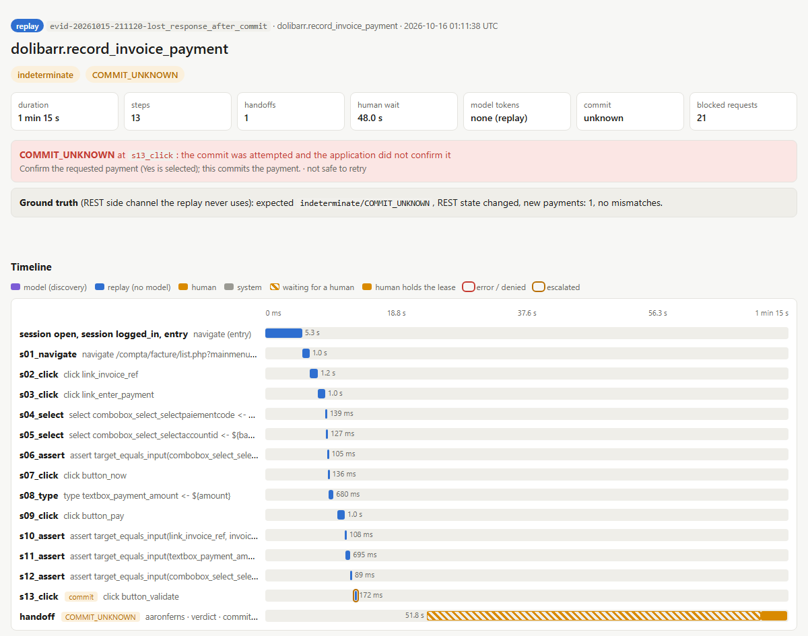

# REPORT

## 1. Architecture

- In Discovery, a model drives the live Dolibarr app and every action is recorded (cua discover)
- Compiled capability is created from the model run (cua compile)
- Validate and approve (cua validate, cua approve, approver signs the hash)
- No model replay process (cua replay)

It's one python process, Playwright drives Chromium and a FastAPI operator console shares its event loop, so both act on the same live page.  

**Discovery: I**t's one loop: Observe the main content's accessibility outline (text, screenshots optionally), ask the model for one closed-vocabulary action, check policy, act and record. Inputs reach the model only as {{name}} tokens and it stops on done, 30 turns or 7 minutes, the stuck detector, a model refusal or error or request_help.

These are some of the architecture decisions made


| Decision                                        | Why                                                                                                                                                                                                                                         | Rejected                                                                                                                       |
| ----------------------------------------------- | ------------------------------------------------------------------------------------------------------------------------------------------------------------------------------------------------------------------------------------------- | ------------------------------------------------------------------------------------------------------------------------------ |
| No model in replay                              | Cost, latency, determinism and that prevents production data from being sent to an LLM                                                                                                                                                      | One-step model fallback during replay. Even one LLM-generated action breaks the data boundary                                  |
| Perceive via the accessibility snapshot         | The same representation can be used to observe, act, record, replay. Desktops have the same tree                                                                                                                                            | Screenshot + coordinates because that causes brittle replay. Moving a button might break everything. The tree remains the same |
| Own closed action vocabulary, one model adapter | It is the artifact's vocab and belongs to my system and so banks choose their model vendor                                                                                                                                                  | Vendor toolset lock-in                                                                                                         |
| No agent framework                              | A workflow checkpoint can't hold the live browser a handoff needs                                                                                                                                                                           | LangGraph, BrowserGym                                                                                                          |
| Python + Playwright                             | Playwright uses both but desktop and vision tooling is Python-native                                                                                                                                                                        | TypeScript                                                                                                                     |
| Dolibarr ERP as the bank proxy                  | Invoice payment is shaped like a posting (search, record, confirm, irreversible write). It's also a legacy markup I didn't write and is enough to demonstrate high-risk actions and approvals. Its REST API acts as an independent oracle. | Self-built app (because that would be like grading my own exam) and public demo can't be reset easily                          |


**Model:**  claude-opus-5-5 via the Anthropic SDK

**Evidence:**

- Each run writes a bundle: events.jsonl ( model actions with stated rationale, replay steps, policy decisions, lease changes, human actions), redacted transcript and trace, result.json, and on failure a masked screenshot and snapshot in (evidence/*/failure/). 
- Every committed bundle is rendered in docs/views/        (cua view )
- cua export-otel sends OTLP spans, never screenshots or page text.
- The error replay below lost the response to the payment click so the run stops indeterminate and hands the verdict to a person:



## 2. Artifact schema

A capability is a guarded linear program over classified screen states
(`capabilities/dolibarr/lookup_customer_outstanding@1.0.0.json`, trimmed):

```json
"contract": {
  "inputs":   {"customer_code": {"type": "string", "pattern": "CU\\d{4}-\\d{4,5}", "sensitivity": "pii"}},
  "outputs":  {"outstanding_amount": {"type": "decimal", "sensitivity": "internal"}},
  "outcomes": {"customer_not_found": {"returns": []}, ...}
},
"steps": [{"id": "s01_navigate", "expect": "home", "effect": "read", "timeout_ms": 10000,
           "do": {"kind": "navigate", "route": "/societe/list.php?search_customer_code=${customer_code}"}}, ...],
"success": {"state": "customer_tab", "outputs": ["outstanding_amount"], "checks": [...]},
"targets": {"cell_customer_code": {
  "strategies": [{"kind": "same_row", "label": "Customer Code", "take": "value",
                  "why": "the row's label cell leads to it", "matched_at_record": "1 of 1, same element as ref"}],
  "fingerprint": {"role": "cell", "tag": "td", "row_label": "Customer Code"}}},
"provenance": {"trace_run_id": "...", "trace_sha256": "...", "discovered_by": "claude-opus-5-5", "compiler": "..."}
```

Steps also carry an intent, optional branches (`on`) and an optional verify predicate. Screen states live in a
per-app profile (`apps/dolibarr/profile.json`: signatures, interstitial handlers, login flow, commit routes, default
meanings).

Why this shape?

 A simple click list would be too fragile when the application shows an unexpected screen and a full state machine is hard to review. One run never shows error screens, so states come from the profile. Locators rank role and name, text, then structure, but never on generated IDs (because that might be unstable) , and must match exactly one element by normalized-exact name, the real risk is unique-but-wrong (six Dolibarr filter inputs share one name, so recording the extra info is important). A fallback counts only if its fingerprint matches.

Versioning: semver plus a lock hash over capability and profile, since both change what replay does. Approval is stored in a separate sidecar (approvals/) so approving never changes hashed content. 

## 3. Determinism & error handling

Each step: 

- after a navigation the agent waits for the page to settle (load event, then an identical screen on two polls; tests/surface/test_settle_read.py). It classifies against the profile and resolves exactly one element to act on.
- Before actions it has to check lease and expected effect. 
- After acting it verifies the result (typed values echoed, identity exact, review screen checked before a commit). 
- If the screen is unexpected, the agent tries four things: step branch, expected state, known handler, profile default meaning. if none of them match, it fails closed.

Every run’s outcome maps to one of the classes defined in the brief. A business outcome comes back as business_outcome, with the specific outcome named. Recoverable problems get handled inside the run: a known interstitial, a bounded wait and retry, or a re-login. Re-login is only allowed before a commit. Whatever status the run ends with, it reports those recoveries under recoveries. A hard failure comes back as failure with a code, the step, the expected and observed state, and a masked screenshot. Error messages never echo inputs back (tests/safety/test_error_hygiene.py).

indeterminate is handled separately. It means we can’t tell whether the payment went through. In that case the agent doesn’t retry, it hands the run off to reconciliation.


| Situation                    | Status / outcome                        | Behaviour                                                            | Where                                                                      |
| ---------------------------- | --------------------------------------- | -------------------------------------------------------------------- | -------------------------------------------------------------------------- |
| Normal read                  | success                                 | The outputs are equal to what the REST API returns                   | `evidence/replay_success_other_customer/`                                  |
| Unknown customer             | business_outcome `customer_not_found`   | It's an expected business answer, not a failure                      | `not_found`                                                                |
| User without rights          | business_outcome `access_denied`        | The login recovery is recorded                                       | `no_rights_user`                                                           |
| Nearest match only           | failure `IDENTITY_MISMATCH`             | It never accepts a near miss                                         | `nearest_match`                                                            |
| Known interstitial           | success, recovery recorded              | The interstitial is dismissed and the step is retried                | `interstitial_recovered`                                                   |
| Unknown dialog               | failure `UNKNOWN_DIALOG`                | It fails closed                                                      | `unknown_dialog`                                                           |
| Application error page       | failure `APP_ERROR`                     | It isn't retried                                                     | `app_error`                                                                |
| Slow within / beyond timeout | success / failure `TRANSIENT_EXHAUSTED` | Retries are bounded                                                  | `slow_within_timeout`, `slow_beyond_timeout`                               |
| Session expired              | success, recovery `login`               | It logs back in and restarts, but only if no commit was attempted    | `session_expired`; `test_session_expiry_after_a_commit_is_never_restarted` |
| Login CAPTCHA                | escalation, then success                | Only a human can solve it                                            | `evidence/replay_captcha_handoff/`                                         |
| Overpayment                  | business_outcome `validation_rejected`  | The automation never answers Yes                                     | `overpayment`                                                              |
| Response lost after commit   | indeterminate `COMMIT_UNKNOWN`          | The button is clicked once and never retried                         | `evidence/replay_commit_unknown/`                                          |
| Policy denies the route      | failure `POLICY_DENIED`                 | The run is refused before any UI action                              | `evidence/replay_policy_denied/`                                           |


The bare names in the Where column are live suite cases (`capabilities/dolibarr/*.tests.json`), and each one is also
unit-tested in `tests/replay/`. Network faults are simulated with browser routes, but session expiry, the CAPTCHA and
the no-rights user are real server states.

**Drift:** If a fallback locator resolves, it gets used and the run reports it (`tests/replay/test_replay_v0.py`).
Output extracts only use the primary locator, so drift can't change where a number comes from.

**Stretch goal (confidence and approval):** this is built.

- Replay refuses to run a capability that hasn't been approved, unless you pass `--allow-draft`.
- `cua validate --repeat` scores stability. The lookup passed 33 of 33 runs with no flakes
  (`evidence/validation_suite.json`) and the payment passed 5 of 5.

## 4. Heterogeneity & multi-tenant

**Surface seam:** Capabilities and profiles hold no browser concepts
(`tests/artifact/test_artifact_schema.py::test_artifact_has_no_playwright_concepts`). Underneath them is a `Surface`
protocol (`src/cua/surface/base.py`), and what it observes is an outline of role, name and ref. That's what lets a
different surface plug in without changing anything above it.


| Surface               | Perception                                                                    | Acting                           | Status                                                     |
| --------------------- | ----------------------------------------------------------------------------- | -------------------------------- | ---------------------------------------------------------- |
| Web (Dolibarr)        | Playwright accessibility snapshot                                             | Role-and-name locators           | Built                                                      |
| Legacy web, framesets | The same snapshot per frame, with the frame stored in each target's fingerprint | Frame-scoped locators            | Designed. Today a target in an empty frame isn't found     |
| Windows desktop       | UI Automation tree, turned into the same outline                              | UIA patterns (invoke, set value) | Designed as a second `Surface`, and nothing above it changes |
| No accessibility      | Screenshot, grounded by the model at record time                              | Coordinates                      | Last resort, and it needs visual verification              |


**Reuse across tenants:** Tenants on the same vendor product differ in labels, modules and policy, but not in flow. So
the profile belongs to the product, and capabilities are recorded once on a reference tenant.

The design (not built yet) is a stack of overlays: product, then version, then tenant. An overlay can override
locators, state text, handlers and policy, but never steps. The lock hash covers the overlays, and approval is per
tenant. I rejected re-recording every capability for each tenant.

**Drift:** This is designed, not built:

- Canary replays per tenant
- A fingerprint of the login page's version, to pick which version overlay applies
- Quarantining a target after it drifts repeatedly

## 5. Escalation & handoff

**Detect:** A run pauses for a person when it hits a login CAPTCHA, an unknown commit outcome, or (during discovery) a
commit that needs approval. Unknown screens fail closed. In discovery, the stuck detector (`tests/agent/test_stuck.py`)
and `request_help` both stop the run, but routing those to a person is designed, not built.

**Route:** The run writes an intervention request (capability, step, reason, state and a masked screenshot) to the
bundle and to the operator console's queue (`tests/control/test_interventions.py`, `tests/control/test_console.py`).

**Take control:** The operator works in the same headed browser the run already owns. Who's allowed to act is tracked
by a lease with a holder and a generation. Claiming the lease increments the generation, and any automated action
carrying an older generation is refused (`tests/safety/test_policy.py`). I rejected a simple pause flag because a
decision made before the handoff could land after control went to the person and came back. The person's clicks,
inputs and requests are all captured, with values redacted (`tests/control/test_capture.py`).

**Hand back:** Resuming returns the lease with a new generation. Then either replay restarts from the entry route on
the same session, or the operator marks the run complete and replay verifies the checkpoint
(`tests/replay/test_handoff.py`). Restarting is better than searching forward because after a re-login the app lands
before the paused step, and several steps share the same screen, so the screen alone doesn't say where you are. Resume
is refused once a commit has been attempted (`tests/control/test_resume.py`). `evidence/replay_captcha_handoff/` shows
the full cycle.

## 6. Safety

Everything is denied unless a layer explicitly allows it. The risky class of action is the **commit**. The procedure is
approved once, and then each request runs at most once. I rejected per-call confirmation because it defeats the point
of automation, and I rejected blocking writes because then there's nothing left to automate. What counts as a commit
is defined by the profile's commit routes (method, path, query, form body), and the capability's declared effect acts
as a ceiling (`tests/replay/test_commit_path.py`).


| Control                      | Enforced by                                                                                             | Shown in                                                              | Limit                                                                                                              |
| ---------------------------- | ------------------------------------------------------------------------------------------------------- | --------------------------------------------------------------------- | ------------------------------------------------------------------------------------------------------------------ |
| Network allow-list           | browser routing blocks other origins, redirects, websockets, downloads, service workers                 | `tests/safety/test_network.py`                                        | one host and port per sandbox policy                                                                               |
| Action policy                | policy file (`policies/*.json`): effect ceiling checked on every action and in a static preflight       | `tests/safety/test_policy.py`, `evidence/replay_policy_denied/`       | per policy, not per user                                                                                           |
| Second-person approval       | lock hash over capability and profile; approver name must differ from `discovered_by`                   | `tests/artifact/test_artifact_lock_approval.py`                       | Names are self-declared labels, and here the author approved both, so there's no dual control                      |
| Commit at most once          | request-ID ledger; intent logged before the click; no retry after an unknown outcome                    | `tests/replay/test_commit_path.py`, `evidence/replay_commit_unknown/` | a lost response needs a human verdict                                                                              |
| Commit approval in discovery | single-use console approval bound to action and lease generation                                        | `tests/control/test_approver.py`, `tests/agent/test_commit_gate.py`   | console only                                                                                                       |
| Secrets and personal data    | scripted login (the model never sees credentials); one redacting writer; masked screenshots; `cua lint` | `tests/safety/test_redact.py`, `evidence/evidence_lint.txt`           | lint reads text; screenshots are masked, not scanned                                                               |
| Human control                | lease holder and generation (§5)                                                                        | `tests/control/test_lease.py`                                         | The console is loopback-only and unauthenticated, so only use it on a single-user machine. Input made before a claim is accepted but not captured |


Discovery sends page text to a model, so it only runs on sandbox data.

## 7. Cuts

Cut, in the order I'd build next:

- A second tenant and the overlays (§4).
- Differential read-back to settle `COMMIT_UNKNOWN` automatically.
- Routing unknown screens and stuck discovery to a person (§5).
- Capturing or blocking input before a claim.
- A desktop surface; frames, popups and pixel surfaces.
- An authenticated, remote operator console.
- Also cut: a second model provider and the model comparison, dual control above a threshold, test-payment cleanup.

**Disclosed:** API credits ran out during the payment discovery, so I finished it by replaying the model's recorded
choices (`evidence/discovery_record_payment/result.json`: `model: scripted`). The model tests weren't re-run at the
end, and the clean-clone run was verified on Windows, not Linux.

**Known issue:** The approved `record_invoice_payment@1.0.0` still has "50 Euros" in one of the commit button's
fallback finders and in its fingerprint. If the primary finder ever missed, the commit would fail closed for any other
amount. The compiler is fixed, and 1.0.0 is waiting for re-approval
(`test_approved_payment_draft_is_the_compiled_trace_plus_exactly_the_reviewed_edits`).