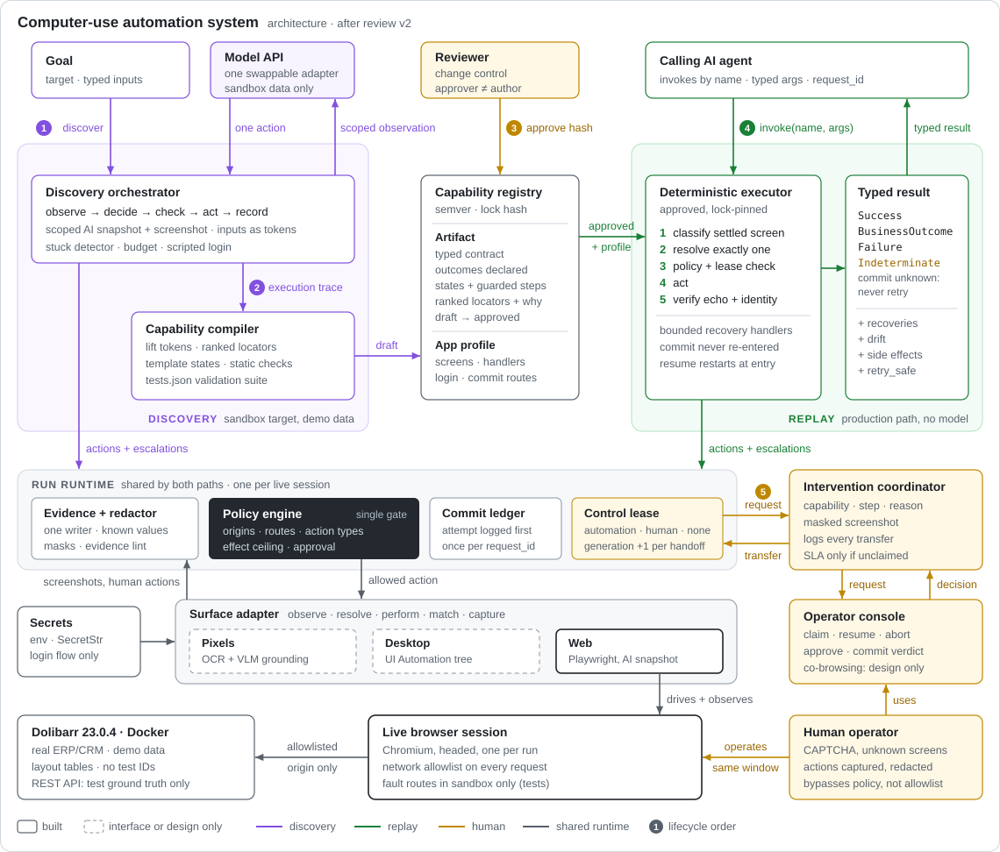

# Architecture Review v2: Computer-Use Automation System (interface.ai Assignment A)

> **Status (2026-10-21):** a record of the review held before any code was written, kept as written. Where it differs
> from the code, the code wins; `REPORT.md` describes the system as built and `docs/implementation-status.md` lists what
> was built, measured and cut.

Pre-implementation review of `docs/DESIGN.md` (v2) against the assignment brief. No code exists yet; nothing in this
review was implemented. `DESIGN.md` is unchanged.

**Date:** 2026-10-11
**Inputs:** the assignment PDF (source of truth), `DESIGN.md`, `architecture.svg`, the local environment.
**Update (same day, after a spike):** the target application changed from a self-built app ("SimCU") to
**Dolibarr 23.0.4**, a real open-source ERP/CRM run in Docker. Every runtime condition in brief §3.3 was reproduced on it
and verified through its REST API (see **Target Decision** below and `spikes/dolibarr/README.md`). SimCU-specific plans
in this document were replaced. Reviewer findings are kept as originally written.
**Method:** six reviewers, each owning one question. Phase 1 was independent review. Phase 2 was cross-examination, in
which each reviewer challenged at least two other reviewers' conclusions. The lead architect then synthesized the result.
Where reviewers still disagree, this document says so.

| Reviewer | Question owned |
|---|---|
| R1 Scope | What is the smallest system that scores extremely well? |
| R2 Artifact + replay | Is discovery → trace → artifact → deterministic replay actually sound? |
| R3 Perception | Which observation and action approach has the best reliability-to-complexity ratio here? (web research) |
| R4 Safety + banking | Are commit handling, escalation, policy and data handling sound, or do they only sound sound? |
| R5 Feasibility | What will this really cost, and what is the critical path? |
| R6 Adversarial reviewer | How would an interface.ai engineer actually grade it? |

**Labels used below**

| Label | Meaning |
|---|---|
| **[REQ §x]** | Assignment requirement |
| **[DD]** | Decision in DESIGN.md |
| **[VERIFIED]** | Checked against a primary source; the source is listed in Appendix B |
| **[INF]** | Inference |
| **[SPEC]** | Speculation that needs an experiment |

---

# Executive Verdict

**Is DESIGN.md fundamentally sound?** Yes, at the level of ideas; no, at the level of mechanisms.

The thesis is right, and it targets exactly what the brief grades:
- The artifact is a guarded, model-free program.
- Business outcomes are declared in its contract.
- Every step carries an effect class.
- Replay never calls a model.

Four load-bearing mechanisms are missing, broken or built on an outdated premise:

1. **States are never defined.** Every `expect`, every `on:` branch and every success check names a state such as
   `member_detail` or `not_found`. No schema field, file or paragraph defines what a state *is* or who writes it. The
   classifier that depends on them is the most load-bearing component and the least specified.
2. **The commit handling has correctness holes.** The flagship timeout-after-commit demo would be misreported as
   `APP_ERROR` under §6.2 precedence. The re-login handler and resume can click Submit a second time. The idempotency
   key is read by nothing. "Read back to confirm it exists exactly once" can't tell our posting from an earlier
   identical one.
3. **Forward-search resume breaks the flagship handoff demo.** After an MFA re-login the app lands on the main menu,
   which is *before* the paused step, so "first step at or after the paused one" finds nothing. Separately, steps share
   screens, so resume can skip a lost typing step and return a false "not found".
4. **Perception is built on an outdated premise.** §3.1 says Playwright's aria snapshot "is built for test assertions",
   so the design builds a CDP accessibility-tree pipeline. Playwright 1.59+ ships `aria_snapshot(mode="ai")`, which
   returns element refs and includes iframes and framesets [VERIFIED]. The CDP route also means two different
   accessible-name engines, one for observation and one for replay.

**Is it over-scoped?** Yes, by roughly 2.5–3×.
- §14 promises 8 days. Bottom-up costing puts DESIGN as written at **20–32 focused days** (R5).
- About half the build list is breadth the brief says it does not reward ([REQ §7], [REQ §8]: "Pick at most one or
  two"): WebArena Verified, a four-model comparison with a self-hosted vLLM contender, four adapter types, a three-layer
  binding chain, OCR redaction, a stability bench and a 16-row test-app table.
- A warning for the fix: when all six reviewers' "must" lists were added together, the total came to **15–22 days**.
  Cutting breadth and then adding depth at the same rate lands back near the original scope. The recommendation below
  is deliberately smaller than that union.

**The 5 strongest ideas (protect these)**

1. **Outcomes in the contract, with a small result taxonomy.** "No such member" is a declared business outcome next to
   typed inputs and outputs. Recoverable conditions are recorded on every result, not turned into a status. Failures
   carry the step, what was expected and what was observed.
2. **Effect class per step, with commits never retried.** One field (`none/read/commit`) drives locator strictness,
   approval, retry safety and the commit protocol. "We don't know whether it posted" is reported as its own status. This
   is the bank-native signal no generic web-automation submission will have.
3. **Identity checkpoint plus the `nearest_match` fault.** This defends against failures that look like success:
   returning nothing beats returning the wrong member's balance.
4. **Inputs passed to the model as tokens** (`{{member_id}}`). Parameterization becomes exact instead of being guessed
   from literals, and the model never *emits* a raw value.
5. **No model in replay, one policy gate, and a control lease with a generation counter.** This gives a clean production
   data story and a real answer to "who is in control right now?".

**The 5 biggest risks**

| # | Risk | Why it matters |
|---|---|---|
| 1 | **State classification on a postback app is the hidden half of the project** | Undefined in DESIGN. Every robustness claim depends on it. R5 estimates 40–50% of total effort if states are inferred automatically, and 20–25% under the recommended split. |
| 2 | **Scope creep produces a shallow build** | R6's mock evaluation: everything built shallowly scores about 2.9/5; a smaller system built deeply scores about 4.2–4.6/5. |
| 3 | **False confidence in commit safety** | The double-submit paths and the misclassified 504 sit inside the very demo meant to show banking judgment. |
| 4 | **Target-app surprises** | The spike didn't exercise Dolibarr's payment form or a validation error. WSL stops the VM (and the containers) when idle. Snapshots are large (~35k characters per page). |
| 5 | **REPORT compression and AI-sounding framing** | 975 lines have to become 1–3 pages under 7 fixed headings. MPC/HER analogies, coaching text, product lists and "fencing epoch" style jargon read as name-dropping or generated text. |

**Recommendation: build Option B (Balanced), about 9.5 ± 1 focused days, against Dolibarr as the target app.**
- It is the smallest system that closes every correctness hole above.
- It touches every §3 requirement with observable evidence.
- It spends depth on the artifact schema, replay error handling, the commit path and handoff, which the brief names as
  load-bearing [REQ §5].
- Option A (Minimum Excellent, about 7.5–8.5 days) is the fallback if the day-3 or day-6 gates slip.
- Option C (about 16–22 days) is not recommended.

---

# Target Decision: Dolibarr instead of a self-built app

**Decision.** Use **Dolibarr 23.0.4**, pinned, plus MariaDB 11.4 in Docker, with Dolibarr's own demo data. Dolibarr is an
open-source ERP/CRM that real small businesses use for customers, invoices, payments and bank accounts. The self-built
SimCU is dropped.

**Why.** The brief allows either choice [REQ §4]. Dolibarr is better on the three properties that matter:

| Property | What Dolibarr gives |
|---|---|
| Concrete | The errors, wording, permissions and legacy markup belong to someone else's production software, so "you built the exam you're grading" largely disappears |
| Reproducible | Every §3.3 condition was triggered on demand in the spike |
| Verifiable | Outcomes are checked against the app's own REST API (invoice status and reference, payments per invoice), not against an endpoint we wrote |

The spike also showed Dolibarr has the brief's legacy traits:
- server-rendered PHP;
- nested layout tables, with labels in neighbouring cells;
- icon-only buttons with empty accessible names;
- filter inputs that all share one help-text name;
- select2 widgets;
- a real substring trap: "Current outstanding bill" vs "Current outstanding bill late".

**How each condition is produced** (all reproduced in the spike unless marked):

| Condition [REQ §3.3] | Mechanism | Verified by |
|---|---|---|
| Record not found | Data: unknown customer code → "No record found" | REST |
| Wrong record ("nearest match") | Data: code `CU1910-0002` matches only `CU1910-00021` (Company Corp 2) | REST |
| Permission denial | Data: a user without rights → Dolibarr's "Access denied … not allowed to your user" page | UI; the API also refuses (403) |
| Confirmation dialog | App: `dialog "Validate invoice"` asking "Are you sure you want to validate this invoice with the reference …?" | UI + REST status |
| Irreversible commit | App: invoice validation (permanent reference) and, planned, recording a payment | REST (status, payments per invoice) |
| Lost response after commit | Harness: `route.fetch()` sends the real request, then `route.fulfill(504)` | REST shows the commit happened |
| Session expiry | Harness: delete the session, so the login form appears at the same URL | UI |
| Human-only step | App config: Dolibarr's login CAPTCHA (`MAIN_SECURITY_ENABLECAPTCHA`); a scripted login is refused | UI |
| Slow or failed load | Harness: route delay, or an injected 500 | — |
| Unexpected or unknown dialog | Harness: dialog injected into the real page | — |
| Validation error | App: a payment above the remaining amount (**not yet exercised**) | REST shows no payment |

"Harness" means a browser-side fault layer in `cua`. It works against any web app, and it is enabled only for sandbox
targets.

**What changes**

| Area | Was (SimCU plan) | Now (Dolibarr) |
|---|---|---|
| Read capability | Member balance | `lookup_customer_outstanding`: customer code → customer name + current outstanding amount |
| Write capability | Open sub-account | `record_invoice_payment`: a money-moving commit where a duplicate creates a second payment; the posting oracle is `GET /invoices/{id}/payments`. Invoice validation (proven in the spike) is the fallback commit. |
| Handoff trigger | MFA | Login CAPTCHA |
| Tenant B (only if ahead) | — | A second Dolibarr instance on the same version, configured differently through Dolibarr's own translation overrides. This is literally "same vendor product, configured differently" [REQ §1]. |
| Reset | — | Restore a database dump taken after seeding (seconds), instead of re-installing (minutes) |
| Commit detection | — | Commits are **GET requests with a CSRF token** (`action=confirm_*&confirm=yes`). The profile declares commit routes by URL pattern; HTTP method is meaningless here. |

**What we give up**
- Framesets and IDs generated per version. Dolibarr has neither; the REPORT states the gap.
- About half the faults are injected in the browser rather than produced by the app. Those are declared as such.
- **Docker becomes a prerequisite** for running live replays. Graders normally have it; committed evidence and the
  offline tests run without it.

**Environment facts from the spike**
- Docker Engine 29 + Compose are already installed in WSL2 Ubuntu 26.04. The earlier "Docker absent" finding only
  checked the Windows PATH.
- Cold start, including the image pull, takes 246 s; a warm start takes 17 s; memory use is about 300 MB.
- WSL stops the VM, and the containers with it, about a minute after the last WSL command exits. Keep a process alive
  or set `vmIdleTimeout=-1`.
- Python on Windows must use `127.0.0.1` rather than `localhost`.
- The Windows console needs `PYTHONIOENCODING=utf-8`.

---

# Assignment Coverage

Requirement-by-requirement mapping for the recommended build. "Evidence" names the committed bundle or test a grader
can open.

| Brief | Requirement | Recommended implementation | Evidence | Status |
|---|---|---|---|---|
| §2.1, §3.1 | Goal in natural language plus a target | `cua discover --app dolibarr --goal "…" --input customer_code=…:string --output outstanding_amount:decimal`. The entry route comes from the app profile. | `discovery_lookup_customer_outstanding/manifest.json` | BUILD |
| §2.2, §3.1 | LLM observe → decide → act loop with stop conditions | One loop. It observes (AI snapshot + screenshot + page facts), the model proposes one tool call with a rationale, the policy guard checks it, then it acts and records. It stops on a verified `done`, the step budget, a timeout, the stuck detector, `request_help`, or repeated policy violations. | `discovery_*/events.jsonl`, `llm/transcript.jsonl`; `test_loop_stops_on_*` | BUILD |
| §3.1 | Real UI interaction; bias toward surfaces with no clean DOM | Dolibarr 23.0.4, a real server-rendered ERP/CRM: nested layout tables, label and value cells, icon-only buttons with empty names, filter inputs sharing one help-text name, select2 widgets, full-page posts. Observation is the accessibility tree (scoped to the main content) plus a screenshot; the agent acts by element ref. | Discovery bundles; `spikes/dolibarr/README.md` | BUILD |
| §2.3, §3.2 | Ordered steps / actions | `steps[]` in a closed action language, kept as a linear main path with `on:` branches only where a step can branch | Capability JSON in `capabilities/` and evidence | BUILD |
| §3.2 | How each target is identified, *with robustness reasoning* | Ranked strategies per target. Each carries a `why` and its record-time match count ("1 of 1, same element as ref"), plus a record-time fingerprint. | Capability JSON; review card | BUILD |
| §3.2 | Typed input parameters | `contract.inputs` with type, pattern and sensitivity; tokens make lifting exact | Capability JSON; JSON Schema export | BUILD |
| §3.2 | Typed outputs and their shape | `contract.outputs` with type, scale and sensitivity; parsed and validated on extract | `replay_success_other_customer/result.json` | BUILD |
| §3.2 | Checkpoint / success condition | Per-step `expect` states, an identity `assert`, value echo after typing, and a `success` block (state + outputs + checks) | `replay_nearest_match/`, `replay_success_*` | BUILD |
| §3.2 | Versioned and reviewable by a human and a calling agent | Semver; the capability body is hashed while status lives in a sidecar; the lock hash covers capability + profile + overlay; markdown review card; JSON Schema export of the contract | `approvals/*.json`, `*.review.md`, `cua capabilities --json` | BUILD |
| §2.4, §3.3 | Replay without the LLM | Model-free interpreter; a test asserts the `replay` package never imports `agent` | `test_replay_never_imports_model_code` | BUILD |
| §3.3 | Stable targeting, verify checkpoint, return outputs | Exactly-one resolution; normalized-exact names; fingerprint gate on fallbacks; strict primary-only resolution for commits and output extracts | `test_resolver_*`; replay bundles | BUILD |
| §3.3 | Validation error | Write flow: a payment above the invoice's remaining amount gets Dolibarr's own error → `business_outcome(validation_rejected)` (confirm in M0) | Suite case + REST: no payment created | BUILD |
| §3.3 | Record not found | Unknown customer code → Dolibarr's "No record found" → `business_outcome(customer_not_found)`, a state that `specializes` the list screen | `replay_not_found/` | BUILD |
| §3.3 | Permission denial | A user without rights gets Dolibarr's "Access denied" page → `business_outcome(access_denied)` | Suite case | BUILD |
| §3.3 | Unexpected dialog | A known interstitial is dismissed by a budgeted handler and recorded in `recoveries[]`. An *unknown* dialog fails closed and escalates; it is never dismissed. Both are injected into the real page by the fault harness. | `replay_interstitial_recovered/`, `replay_unknown_dialog/` | BUILD |
| §3.3 | Session / timeout expiry | Session deleted server-side → login form at the same URL → re-login handler (recovery). With Dolibarr's login CAPTCHA on, re-login needs a human → escalation and handoff. | Suite case; `replay_captcha_handoff/` | BUILD |
| §3.3 | Slow or failed load | Fault harness: `slow:<ms>` within the step timeout (recorded in timings) vs beyond it (`TRANSIENT_EXHAUSTED`); injected `app_error` → hard failure | Suite cases | BUILD |
| §3.3 | Business / recoverable / hard separation; step, expected, observed | Four terminal statuses: `success`, `business_outcome`, `failure`, `indeterminate`. `recoveries[]` appears on every status. `failure` carries code, step, expected, observed (with signature near-misses) and evidence refs. | Every `result.json` | BUILD |
| §3.4 | Configurable allowlist of routes and action types | One policy file, enforced (a) in the guard on every automated action and (b) by browser-context network routing (origins, schemes, path rules on navigations and form posts; service workers blocked) | `replay_policy_denied/`; `test_guard_*`, `test_network_*` | BUILD |
| §3.4 | Safe vs risky handling, with justification | Effect classes come from profile annotations; the regex can only raise a class. Commits need approval in discovery and an approved artifact in replay. Commits are never retried. Pre-commit review verification. Each capability's declared effect is a ceiling. | `discovery_record_payment/`, `replay_commit_unknown/` | BUILD |
| §3.4 | Never persist secrets or raw PII | Login is a scripted profile flow, so the model never handles secrets. One evidence writer redacts known values and patterns. DOM masks on screenshots, including a generic mask on failure and escalation screenshots. `hide_input_in_errors`. No traces or HAR committed. An evidence-lint test scans `/evidence`. | `evidence/evidence_lint.txt`; `test_evidence_lint` | BUILD |
| §3.5 | Structured log of what and why; a richer signal on failure | `events.jsonl` (one schema for agent, replay, human and system actors, with rationale); masked screenshot plus redacted snapshot on failure and escalation | All bundles | BUILD |
| §3.6 | Detect stuck and route with context | Stuck detector (repeated screen signature with no progress), unknown state, login CAPTCHA, commit unknown, approval. The intervention request carries capability, step, reason, classified and expected state, and a masked screenshot. | `replay_captcha_handoff/interventions/*.json` | BUILD |
| §3.6 | Human controls the *same* live session; actions captured; hand back | Headed Chromium owned by the run. Lease holder and generation. The minimal console offers claim, resume, abort, approve, mark-complete and commit verdict. Capture uses an init script, an exposed binding and a request log. Resume re-enters from the entry on the same session. | `replay_captcha_handoff/` | BUILD (remote co-browse is DESIGN ONLY) |
| §3.7 | Surface abstraction | `Surface` protocol in code with one web implementation. Artifacts contain no Playwright concepts, enforced by a test. REPORT gives a 3-row surface table (legacy web built; desktop UIA and pixels designed). | `test_artifact_has_no_playwright_concepts` | DESIGN (seam built) |
| §3.7 | Multi-tenant reuse and drift | Capability recorded on a reference tenant; one tenant overlay layer (strategies, signature text, enabled handlers); `drift[]` on fallback use. The family → version → tenant chain, canaries and scoped re-discovery are described. | Tenant B bundles: a second Dolibarr instance with translation overrides (only if ahead) | DESIGN (+ optional build) |
| §4 | A real discovery run, evidenced | Committed transcript, events, screenshots and draft. A test shows that compiling the committed trace reproduces the committed draft's hash. | `discovery_*/`; `test_compile_from_trace_reproduces_draft` | BUILD |
| §5 | Complete vertical slice; cuts stated | Milestone M2 is the full thin thread by day 3. REPORT §7 lists cuts. | — | BUILD |
| §6 | README: setup, keys, offline run, exact demo commands | `cua demo up` starts and resets the Dolibarr containers (no bash `&`). Replay needs no key. A scripted adapter replays the recorded transcript for offline tests. Commands for PowerShell and bash. | README | BUILD |
| §6 | REPORT.md, 7 headings, 1–3 pages | Skeleton written at M0 with a word budget and a concept budget | REPORT.md | BUILD |
| §6 | `/evidence/`: artifact + discovery log + replay log + an error replay | About 10 curated bundles, an index, the lint output and suite results | `evidence/README.md` | BUILD |
| §8 | At most one or two stretch goals | (1) **Confidence & approval**: approval gate + validation-suite record + `--repeat N`. (2) **Cross-tenant reuse**: tenant B, built only if ahead. | — | BUILD (1), ONLY IF AHEAD (2) |

---

# Findings by Reviewer

## R1 Scope (MVP architect)
- **Core.** The core of DESIGN (guarded steps, five-status result, effect classes, commit-unknown, exactly-one,
  precedence, lease and epoch) maps directly onto the five things the brief says it will focus on [REQ §5].
- **Breadth that should go.** WebArena, the model comparison, open-weight models, four adapters, the stability bench,
  OCR, traces and HAR, and a 15-row SimCU. §12's "cheap byproducts, not counted" still counts as five stretch goals.
- **Under-served by DESIGN.**
  - Robustness reasoning *inside* the artifact [REQ §3.2, read literally].
  - A REPORT skeleton with a page budget.
  - An evidence index.
  - A test that replay doesn't import model code.
  - Cross-platform "easy to run".
- **Overclaims.**
  - "The model never sees raw input values" is false once a value is on screen. The correct claim is that it never
    *emits* them.
  - The lease fences automation only, not the human.
- **Phase 2 changes.**
  - Conceded the commit-correctness fixes, `indeterminate`, restart-from-entry resume and most of Design B.
  - Estimate moved from 5 days to 7 (range 6–9).
  - **Still holds:** no differential read-back by default, no coverage-gated approval, tenant B last, `policy_denied` kept
    as a status (low conviction).

## R2 Artifact + replay
- **Shape.** The artifact is a *guarded linear program over classified screen states*, not a state machine, and that is
  the right shape. Say so honestly.
- **"Deterministic" is sound only once restated:**
  - **D1:** no model is consulted.
  - **D2:** closed world; every possible action is enumerated in the hash-locked artifact.
  - **D3:** functional determinism over *settled, classified* states.
  - **D4:** fail closed.
- **Six concrete breaks (K1–K6):**

  | # | Break |
  |---|---|
  | K1 | Resume fails after MFA, or produces a false "not found" |
  | K2 | A misbound fallback field yields a false business outcome |
  | K3 | An `extract` has no postcondition, so the ledger balance can come back as success |
  | K4 | `get_by_role` substring matching makes "Advanced Search" the unique wrong match |
  | K5 | The example artifact can't succeed as written: `member_display_name` is never extracted; the identity target resolves to the label, not the value; `success` uses predicates not in the language |
  | K6 | Approval doesn't bind to what executes: status and hash sit inside the hashed body; profile and binding edits change behavior without re-approval; tenant `handlers_add` injects actions |

- **The compiler claims more than it can know.**
  - "Validated as mutually exclusive" holds only on observed snapshots.
  - Pruning no-ops by signature drops necessary steps.
  - Outcome states never appear in a happy-path trace.
- **Phase 2 changes.**
  - Dropped the separate verifier, accepting R3's evidence that it is circular on legacy markup.
  - Accepted hand-authored profile states and four statuses.
  - Moved from "always restart" to rewind-to-earliest-match with restart as a fallback (see D1).
  - **Refuses to cut:** explicit states with `specializes`; outcome codes in the contract; per-step effect; verification
    as first-class steps; lock-hash approval.

## R3 Perception (web research)
- **AI snapshot replaces the CDP pipeline [VERIFIED].**
  - Playwright `aria_snapshot(mode="ai")` (1.59+) gives `[ref=eN]` refs and includes iframe and frameset content. Frame
    refs are routed by Playwright itself.
  - `boxes` was added in 1.60; `locator.normalize()` in 1.59.
  - PyPI's latest is 1.63.0, and `get_by_ref` is documented for 1.64.
  - Recommended alternative scores 37/40 against 28/40 for DESIGN's CDP approach.
- **Facts found in Playwright source [VERIFIED]:**
  - An unlabeled table input has accessible name `""`.
  - Every alt-less `<input type=image>` is named `"Submit"`.
  - Nested layout tables appear as nested `table/row/cell`.
  - Non-exact name matching is case-insensitive substring; `exact=True` is a case-sensitive full match.
  - The AI snapshot silently drops child-frame errors, returning an empty iframe.
- **Set-of-marks evidence is mixed** (VisualWebArena small gain; OSWorld and SeeAct negative). Keep it off by default.
- **DESIGN fact-check.**
  - The Anthropic `browser_toolset_20260801` exists and is client-executed [VERIFIED].
  - WebArena Verified appeared at a NeurIPS 2025 *workshop* (SEA), not the main track.
  - There is no public `backendDOMNodeId → Locator` path.
- **Phase 2 changes.**
  - The native browser-toolset adapter moved from optional to **not built**: it improves no graded criterion.
  - The same-row replay finder is kept.
  - Normalized-exact matching is proposed (anchored, case-insensitive, optional trailing `:`/`*`).
  - A record-time fingerprint gate is proposed instead of a label verifier.
  - Default provider: the Anthropic SDK directly, OpenRouter as fallback.

## R4 Safety + banking
- **Commit handling is a set of terms, not a protocol.** The specific false-confidence items:
  - FC1: read-back can't attribute a posting.
  - FC2: the idempotency key is unused.
  - FC3: "never retried" holds on one code path only.
  - FC4: a 504 is classified `APP_ERROR`.
  - FC5: `retry_safe` ignores the human's actions during handoff.
  - FC6: the button-name regex misses SimCU's own unnamed image buttons.
- **Approval vs authorization.** "Maker-checker" is the wrong word for approving an artifact; that is change control.
  The discoverer can self-approve.
- **Data handling effort is aimed at the wrong places.**
  - Over-invested: OCR, Luhn, pausing traces around secrets.
  - Real leak points: pydantic errors include input values by default [VERIFIED]; `Failure.observed` on an identity
    mismatch holds a third party's member number; escalation screenshots of *unknown* screens go unmasked; HAR cookies
    and the login POST body.
- **Network hardening.** Service workers bypass `context.route` unless blocked [VERIFIED]. `accept_downloads` defaults to
  true [VERIFIED].
- **Safety evidence gap.** Three of the five Safety-criterion nouns have no evidence: policy denial, redaction and
  injection containment.
- **Phase 2 changes.**
  - Differential read-back and the durable request-id store moved from MUST to MUST EXPLAIN under a tight budget.
  - Six statuses became four.
  - Accepted restart-from-entry resume under four conditions.
  - **Still holds as non-negotiable:** the post-attempt override (non-confirmation means unknown), no re-entry into a
    commit, pre-commit review verification, a write flow that goes all the way through Submit, and evidence lint.

## R5 Feasibility
- **Environment** [VERIFIED locally]:
  - Python 3.12.1, uv and Node are present.
  - Docker, an NVIDIA GPU and Tesseract are absent. *(Corrected by the spike: Docker Engine 29 + Compose are installed
    inside WSL2 Ubuntu; only the Windows PATH lacked them.)*
  - WSL2 Ubuntu exists but is stopped.
  - Playwright and its browsers are not installed.
  - `cua/` sits inside a git repo rooted at `Projects/`, under a path with spaces.
- **Effort.**
  - DESIGN as written: 20–32 days.
  - Union of the panel's musts: 15–22 days.
  - Recommended plan: 9.5 ± 1.
  - Minimal: 6–8.
- **The hidden 50% is "state":** settle detection on frameset postbacks, `wait_for_any`, and the classifier shared by
  replay, outcomes, handlers, the stuck detector, resume and validation.
- **Windows traps** [VERIFIED]:
  - `uvicorn --reload` switches to a selector event loop, which breaks Playwright's subprocess launch.
  - Bash `&` in the README fails in PowerShell 5.1.
  - Native dialogs auto-dismiss.
  - `fill()` bypasses input masks.
  - CRLF line endings change content hashes.
- **Phase 2 changes.**
  - Restart-from-entry resume.
  - Template-proposed states, which cut the hidden share to 20–25%.
  - The stability runner becomes a `--repeat` flag.
  - The cassette is merged into the scripted adapter.
  - The status line moves into the main frame.
  - A ranked cut list with a ~10-day budget line.

## R6 Adversarial reviewer
- **Mock scores.**
  - S1 (everything built, shallow): about 2.9/5.
  - S2 (≈40% smaller, deep, excellent evidence): about 4.3–4.6.
  - Combined recommended build: about 4.2 with solid execution, about 4.9 with the 4→5 moves listed in Phase 2.
- **AI-generated or name-dropping signals to remove from anything shipped:**
  - the "Where your background is the differentiator" table;
  - §15's scripted interview answers;
  - MPC and HER analogies (both technically wrong here);
  - "closed-loop policy";
  - product lists;
  - the 19-row decision record and four debate tables;
  - aphorisms such as "it's blind, not deterministic".
- **The 30-minute moments that land:**
  - three replays with three different statuses, one of them `IDENTITY_MISMATCH` returning no balance;
  - a commit bundle that records the attempt before the single click and ends "unknown, don't retry";
  - a REPORT §3 taxonomy table with an evidence path on every row.
- **Phase 2 changes.**
  - Four statuses.
  - Restart-from-entry, which reads better in an interview *and* is correct.
  - A `tests.json` suite with computed coverage and no waivers.
  - The stability runner is replaced by an optional settle-rule **jitter ablation**.
  - A **concept budget**: every named concept must appear in a test name or evidence path, or it stays out of the REPORT.

## Cross-examination: disputes and resolutions (Phase 2)

Defaults apply unless the listed experiment is run and contradicts them.

| # | Claim A | Claim B | Evidence (summary) | Experiment that resolves it | Cost | Default decision |
|---|---|---|---|---|---|---|
| D1 Resume after handoff | Forward search plus commit guard (DESIGN; R1/R4/R5/R6 in Phase 1) | Restart from entry if no commit was attempted (R2 Phase 1). R2 later proposed rewinding to the earliest matching step, with restart as a fallback. | K1: after MFA the app lands before the paused step. Steps share screens, so forward search skips a lost `type`. Restart costs ~0.1 d and reuses the handler path. Restart breaks on mid-flow manual gates, locks and long flows, none of which exist in our two flows. | Resume matrix: take control at step k, do m manual steps (including Submit), resume. Compare forward / restart / rewind against the server-side posting count. | 1–2 h after M5 | **Restart from entry on the same session** (R1, R4, R5, R6 converged), under R4's four conditions. R2's rewind is recorded as the design for long flows. **R2 dissents.** |
| D2 Result statuses | 3 terminal + design-only RunHandle (R2 Phase 1) | 6 including `policy_denied`, `escalated`, `indeterminate` (R4 Phase 1); 5 (DESIGN, R1) | The brief names three result kinds [REQ §3.3]. "We don't know whether it posted" has a distinct caller duty, and the caller is an LLM agent. `escalated` is a lifecycle state, not a result. | LLM-caller misread test: present commit-unknown as `failure + retry_safe=false` vs `indeterminate`; count re-invocations and wrong member messages. | ~1 h | **4 terminal statuses:** `success`, `business_outcome`, `failure`, `indeterminate`. Policy denial = `failure` with category `policy` and `approvable`. **R1 dissents mildly** (would keep `policy_denied`). |
| D3 Commit protocol depth | Attempt event + no retry + escalate (R1 Phase 1) | `request_id` + compare-and-set + invariants I1–I4 + differential read-back + two bundles (R4 Phase 1) | Minimal version ships two bugs (504 misclassified; re-login re-clicks). Read-back adds ~0.5–1.5 d and mostly buys attribution, which we can decline to claim. | Build the minimal version first, then run the posting-count tests (504; session expiry right after Submit; human Submit then resume). | 2 h | **Sound subset:** attempt recorded before the click, post-attempt override, no re-entry, pre-commit and confirmation verification, `indeterminate`, operator verdict, posting-count oracle tests. Option B adds a `request_id` at-most-once ledger. Differential read-back is **ONLY IF AHEAD** (4 h box). |
| D4 Validation before approval | One different-input replay + two-run diff (R1, R6 Phase 1) | `tests.json` + coverage map + waivers + lock hash (R2) | The suite is the same harness as the fault matrix and `make-evidence`, so ~0 extra. Waivers are ceremony in a one-person project. | Count defects the suite catches that one replay misses. | 2–3 h | **`tests.json` suite** (including a different customer) + computed coverage printed on the review card + lock-hash approval. No gate, no waivers. |
| D5 Target representation | Inline ranked strategies + overlay (R1); logical target + bindings (R3, R5); label-free targets (R6) | Finder + independent verifier with exact names (R2) | R3 [VERIFIED]: unlabeled inputs have name `""`; image buttons are all "Submit"; a cell's name is its value. A label verifier is circular there. | Seeded misbinding: "Advanced Search" next to a renamed "Search"; reordered label rows on tenant B. Count wrong hits caught. | ~1–2 h | **Inline ranked strategies** (each with `why` and record-time count) + **record-time fingerprint gate** on any non-primary hit + **normalized-exact** names + value echo + strict primary-only resolution for commit and output extracts. No verifier block. R1 and R6 argued for a verifier before R3's evidence and did not re-argue. |
| D6 Who authors states | All hand-authored in the profile; the compiler only maps (R1, R5) | Compiler-proposed observed states, human-declared outcomes, profile shared states (R2) | Automatic discriminating search is the "hidden 50%". A fixed template plus a collision check is ~0.25 d. A6: keep "the model discovers" true. | Fraction of template-proposed signatures that survive a different-input suite run unedited. | 1–2 h after M2 | **Template-proposed** (URL glob + first main-frame heading) + collision check against the run's own snapshots + human confirmation. `origin` and `edited` recorded per state. Outcome and profile states hand-written. 0.5 d box; on overrun, hand-author everything. |
| D7 Stability runner | Delete (R1) | Keep as a stretch slot (R6 Phase 1) | N/N against a deterministic local app mostly measures the fault injector. Timing is the only real nondeterminism. | Settle-rule jitter ablation (20 runs, rule on vs off). | 2–3 h | **`--repeat N` on the suite runner**, counted under "Confidence & approval". The ablation is ONLY IF AHEAD. |
| D8 Tenant B | Last, optional (R1, R5) | Small stretch #2 (R2, R6) | Generalization ranks 5th; the design story is accepted [REQ §3.7]. | — | — | **ONLY IF AHEAD**, after the write flow. Two bundles: fails closed without the overlay, passes with it. |
| D9 Label proximity | Same-row rule (R1) | No hints; rely on the snapshot (R3 Phase 1) | Two separate things. Replay needs a same-row finder because the name is `""`. Observation hints are unproven. | Spike 3 wrong-field rate with and without hints. | in Spike 3 | **Same-row replay finder** (direct-child cell anchor, NBSP folded). **No observation hints** in v1. |
| D10 Frameset | Spike then decide (R1) | Core with a status frame (DESIGN, R2) | AI snapshot handles frames [VERIFIED]. A separate status frame adds a frame-lag misclassification class. | Spike 1. | 2 h | ~~nav + main frameset, gated on Spike 1~~ **Superseded:** Dolibarr has no frames. Frame handling stays in the design; the REPORT names the gap. |
| D11 Write flow | Thin, fallback "stop at review, Submit policy-blocked" (R1) | Full commit demo is a must (R4, R6) | It is the only place §3.4 risky handling and §3.6 "risky step needs a person" are demonstrated. | Calendar gate. | — | **Through Submit** after handoff. Policy-blocked Submit is only an emergency cut and a free `policy_denied` prefix. |
| D12 Offline discovery | Scripted fake adapter (R1) | Cassette (R5, R6) | Same mechanism. A compile-from-trace hash test proves provenance better than a cassette. | — | — | **One scripted adapter** that can load the recorded transcript, plus the **compile-from-trace hash test**. |
| D13 `escalated` interim | Design only (R1, R2) | Interim + `cua status` poll (R4 Phase 1) | A non-blocking CLI needs a resident daemon (0.5–1 d). | — | — | **Blocking CLI** emits an interim `escalated` event; RunHandle and the daemon are DESIGN ONLY. R4 conceded. |
| D14 Effect classes | Build none/read/commit (R2, R4) | Four built (DESIGN) | The planned flows have no `write` behavior. | — | — | **Build `none/read/commit`**; explain `write`. The enum does not include `write`, to avoid a design-only dependency. |
| D15 Approval | draft/approved + hash (R1) | Lock hash + coverage + waivers (R2); action-bound approval token (R4) | K6 is real. Waivers are ceremony. Binding to action + generation is ~15 lines. | — | — | **Lock hash** (capability + profile + overlay) in a **sidecar approval**, approver ≠ discoverer, "change control" wording; discovery commit approval bound to (action, generation), single use (Option B). |

---

# Three Architecture Options

All three share the non-negotiable thread [REQ §5]: a real discovery run → saved capability → deterministic replay with
params, outputs and error handling → human takeover of the live session → evidence for both runs.

## Option A: Minimum Excellent (≈7.5–8.5 days, range 7–9)

**Components**

- **Target app.** Dolibarr 23.0.4 + MariaDB in Docker with demo data; a REST seed script and a database-dump reset;
  a browser-side fault harness; data-driven outcomes (not found, near-miss record, access denied).
- **Discovery.** Playwright AI-snapshot perception; one model adapter plus a scripted adapter; closed action schema;
  input tokens; stuck detector; scripted login.
- **Artifact.**
  - Recorder, and locator synthesis on Playwright's own engine.
  - Compiler: a linear pipeline with template-proposed states.
  - Capability schema with inline strategies, fingerprint and normalized-exact names.
  - A profile screen catalog with `specializes` and handlers.
- **Replay.**
  - Interpreter with a settle/fence classifier.
  - Identity checkpoint, value echo, strict extracts.
  - Four-status result.
- **Validation and approval.** `tests.json` suite; lock-hash sidecar approval with approver ≠ discoverer.
- **Handoff.** Lease with generation; minimal console; capture; restart-from-entry resume.
- **Write flow** through Submit with commit-lite:
  - attempt recorded before the click;
  - post-attempt override (non-confirmation means unknown);
  - no re-entry;
  - pre-commit and confirmation verification;
  - `indeterminate` status and an operator verdict.
- **Safety and evidence.**
  - Policy guard and network routing with hardening flags.
  - One redacting evidence writer, DOM masks, evidence lint.
  - About 8 bundles; README and REPORT.

**Technical risk.** Medium. Spike 1 and the classifier are the main risks.

**What gets demonstrated.** Every §3 requirement, including commit-unknown, identity mismatch and the CAPTCHA handoff,
all on a real app.

**What remains design only:**
- caller-level de-duplication (`request_id`) and process-death recovery;
- read-back;
- tenant B;
- policy preflight;
- the family → version → tenant chain, desktop and pixel surfaces, the remote console.

**Likely evaluation strengths.** Clear and small. The correctness holes are all closed. Easy to run and defend.

**Likely evaluation weaknesses.**
- Generalization is design-only (about 3–4).
- Safety evidence is thinner: no policy-denied bundle.
- Human-commit detection is conservative, so any human control on a write capability ends `indeterminate` unless the
  confirmation is verified.

**Interview story.** "I built the thread end to end and spent depth only where a wrong answer costs money: which record,
which balance, and whether a commit happened."

## Option B: Balanced (≈9.5 ± 1 days), RECOMMENDED

**Components.** Everything in A, plus:

| Addition | What it buys |
|---|---|
| `request_id` at-most-once ledger (JSON exclusive-create or one SQLite table), startup sweep of attempted rows to unknown | A same-ID re-invoke returns the stored result with zero UI actions |
| Request log during human control (method, path, form-event target vs profile commit routes) | Human-commit detection is evidence-based, not merely conservative |
| Scripted-human posting-count tests | Session expiry right after Submit; human Submit then resume |
| Static policy preflight, path rules on navigations and form posts, a `replay_policy_denied` bundle | Policy denial is demonstrated, not described |
| Discovery commit approval bound to (action, generation), single use | Approval can't be spent on a different action |
| Coverage computed and printed on the review card | Shows which declared branches were exercised |
| `--repeat N` | Stability signal inside the "Confidence & approval" stretch goal |
| Unknown-dialog fail-closed bundle | The answer to "you built your own exam" |

Then, **only if ahead**, in this order: tenant B overlay (2 bundles), differential read-back (4 h box), settle jitter
ablation.

**Effort.** About 9.5 ± 1 days (R5 bottom-up, cross-checked by R1 at 7 + boxed additions and by R6 at 7–9 + 1.5–2).

**Technical risk.** Medium. Same as A plus capture and request-log integration.

**What gets demonstrated.** Everything in A, plus at-most-once across invocations, policy denial, evidence-based
human-commit detection and a fail-closed response to an unanticipated screen.

**Design only.** Read-back (if not reached), the binding chain, desktop and pixel surfaces, the remote console,
model-assisted recovery, RunHandle.

**Likely evaluation strengths.** Robustness, HITL and Safety can each reach 5 [R6]. Every safety claim points to a test
or bundle.

**Likely evaluation weaknesses.** More named concepts, so System design and Communication depend on disciplined REPORT
editing under the concept budget.

**Interview story.** A's story, plus: "our at-most-once guarantee is a stored record and a test, not a code path; every
safety claim in the report has a test name next to it."

## Option C: Research / Showcase (≈16–22 days)

**Components.** Everything in B, plus all of these:
- every only-if-ahead item;
- R2's Design A elements: a family/version/tenant overlay chain with a label dictionary, outcome payloads, all-finder
  drift telemetry with commit consensus, a `capture-state` signature tool, coverage-gated approval with waivers,
  parameterized states;
- a RunHandle daemon and an injection-containment bundle;
- one WebArena Verified template with a Magento profile and offline scoring;
- a two-model discovery comparison;
- bounded single-step model recovery;
- a CDP-screencast console.

**Technical risk.** High. Docker isn't installed, the Magento image is 2.9 GB, a second app profile recreates the "own
exam" problem, and model-comparison statistics are weak at small n.

**What gets demonstrated.** Breadth, plus an outside benchmark for discovery.

**Likely evaluation strengths.** Ceiling on Generalization.

**Likely evaluation weaknesses.** It contradicts [REQ §7] ("we do not reward feature breadth … scaling
infrastructure") and [REQ §8] ("at most one or two"). The depth per piece drops toward scenario S1 (≈2.9).

**Interview story.** A defense of breadth, which is the worst framing for this brief.

**Choice: Option B**, with Option A as the fallback triggered by the day-3 and day-6 gates (see Roadmap).

---

# Feature Triage

Scores are 1–5.
- **Eval:** how much it moves a §7 criterion.
- **Cost:** 5 = expensive.
- **Risk:** integration risk, 5 = high.
- **Evid:** strength of the observable evidence it produces.
- **Intv:** interview value.

| Feature | Requirement served | Eval | Cost | Risk | Evid | Intv | Recommendation | Reason |
|---|---|---|---|---|---|---|---|---|
| SimCU local legacy-style app (DESIGN v2) | §4 proxy target; §3.1 | 4 | 3 | 2 | 4 | 3 | **DELETE** | Replaced by Dolibarr after the spike |
| Target: Dolibarr 23.0.4 in Docker (new) | §4 proxy target; §3.1 | 5 | 2 | 2 | 5 | 5 | **CORE** | A real app: its own errors, permissions and legacy markup; outcomes verified through its REST API |
| Legacy traits (nested layout tables, label/value cells, empty-name icon buttons, shared help-text input names, select2) | §1, §3.1 | 4 | 1 | 2 | 4 | 4 | **CORE (given)** | Present in Dolibarr at no build cost [spike] |
| Frameset | §1 legacy | 2 | — | — | — | 2 | **DROP** | Dolibarr has no frames. The REPORT names the gap; frame handling stays in the design (AI snapshot supports it). |
| Generated IDs per version | §1 no stable selectors | 2 | — | — | — | 2 | **DROP** | Dolibarr names are stable. The synthesizer still rejects generated-looking IDs. |
| Label proximity | §3.2 target identification | 4 | 2 | 2 | 3 | 4 | **SIMPLIFY** | Same-row replay finder only. No geometric `right_of`, no observation hints. |
| Faults: browser-side harness + data-driven outcomes (replaces seeded app faults) | §3.3; §6 error replay | 5 | 2 | 2 | 5 | 4 | **CORE** | Route delay, injected 500, lost-504 after a real commit, injected dialogs, server-side session deletion, CAPTCHA toggle. Not-found, near-miss and access-denied come from data. Sandbox-only. |
| Tenant B | §3.7; stretch | 3 | 2 | 2 | 4 | 4 | **ONLY IF AHEAD** | A second Dolibarr instance with translation overrides. Two bundles (without and with the overlay). |
| Second, write capability | §3.4; §3.6 risky step | 5 | 3 | 3 | 5 | 5 | **CORE** | Record an invoice payment (money moves; a duplicate posts twice). Invoice validation is the fallback commit. |
| Lost response after commit (`route.fetch` + 504) | §3.3, §3.4 | 5 | 1 | 2 | 5 | 5 | **CORE** | Proven in the spike against a real commit; the REST API is the oracle |
| CDP AX-tree observation | §3.1 | 2 | 4 | 4 | 2 | 2 | **DELETE** | Replaced by the AI snapshot. Two name engines, frame mapping, no node→locator path. |
| Playwright AI aria snapshot (new) | §3.1 | 5 | 1 | 2 | 3 | 4 | **CORE (Spike 1)** | One engine for observe, act, synthesize and replay; frames built in [VERIFIED] |
| Screenshots | §3.1; §3.5 | 4 | 1 | 1 | 4 | 3 | **CORE** | Plain screenshot to the model; masked when persisted |
| Set-of-marks | — | 1 | 2 | 2 | 1 | 1 | **DELETE** | Mixed evidence. Re-add only if Spike 3 shows wrong-element errors. |
| Model abstraction (adapter interface) | §4; portability | 3 | 1 | 1 | 1 | 3 | **SIMPLIFY** | One interface, one real adapter, one scripted adapter |
| OpenRouter | — | 1 | 1 | 2 | 1 | 1 | **SIMPLIFY** | Fallback configuration only, if that is the key held |
| Anthropic native browser toolset adapter | — | 1 | 3 | 3 | 1 | 2 | **DELETE** | API is real [VERIFIED] but adds a second vocabulary, typing at whatever is focused, coordinate clicks and ~6.6k tokens per request. One design sentence. |
| Open-weight GUI model (UI-TARS/Qwen) | §3.7 pixel story | 2 | 5 | 5 | 1 | 2 | **DESIGN ONLY** | No GPU. Pixel grounding is a design paragraph. |
| Model comparison | — | 1 | 4 | 4 | 2 | 1 | **DELETE** | No criterion rewards it; n too small to rank models |
| WebArena Verified | — | 2 | 5 | 5 | 3 | 2 | **DELETE** | Scores discovery, not replay or HITL; 2.9 GB image; Dolibarr already provides a third-party target. REPORT §7 "next". |
| Custom closed action schema | §3.1, §3.2, §3.4 | 5 | 1 | 1 | 3 | 5 | **CORE** | The model's vocabulary is the artifact's language. Structural injection control. |
| Input tokens | §3.2 typed inputs | 5 | 1 | 1 | 4 | 5 | **CORE** | Exact parameterization. Reword the claim to "never emits raw values"; the raw-value check applies to all string arguments. |
| Secret tokens in the model's vocabulary | — | 1 | 1 | 1 | 1 | 1 | **DELETE** | Login is a scripted profile flow |
| Recorder | §2.3 | 5 | 2 | 2 | 4 | 4 | **CORE** | Trace + candidates + fingerprint + token occurrences |
| Compiler | §2.3; §3.2 | 5 | 3 | 3 | 4 | 4 | **SIMPLIFY** | Linear pipeline. No shortest-path pruning; no inferred mutual exclusivity. |
| State machine artifact | §3.2, §3.3 | 5 | 3 | 3 | 5 | 5 | **CORE** | Call it a guarded linear program over classified states |
| Explicit states + `specializes` + settle/fence classifier (new) | §3.3 | 5 | 3 | 4 | 4 | 5 | **CORE** | Defines the undefined; the classifier is a pure, unit-testable function |
| Logical targets | §3.2; §3.7 | 4 | 1 | 1 | 3 | 4 | **SIMPLIFY** | Target = id + description + role + frame + inline ranked strategies |
| Binding profiles (family → version → tenant) | §3.7 design | 3 | 3 | 3 | 2 | 3 | **DESIGN ONLY** | One tenant overlay, built only if ahead. A two-tenant demo can't tell version from tenant. |
| Closed action and predicate language | §3.2; §3.4 | 5 | 1 | 1 | 3 | 5 | **CORE** | Trim predicates to those used |
| Validation replay | §3.2, §3.3 | 5 | 1 | 1 | 4 | 4 | **SIMPLIFY** | Becomes the `tests.json` suite, including a different customer |
| Approval lifecycle | §3.4; stretch | 4 | 1 | 1 | 3 | 4 | **SIMPLIFY** | draft/approved, lock hash, sidecar, approver ≠ discoverer, "change control" |
| Stability runner | stretch | 2 | 1 | 1 | 2 | 2 | **SIMPLIFY** | `--repeat N` flag. The jitter ablation is ONLY IF AHEAD. |
| Drift warnings | §3.7 drift | 3 | 1 | 1 | 3 | 3 | **CORE** | `drift[]` when a non-primary strategy resolves |
| Scoped re-discovery | §3.7 design | 2 | 5 | 5 | 1 | 3 | **DESIGN ONLY** | One paragraph |
| Quarantine, canaries, version fingerprint | §3.7 design | 2 | 3 | 2 | 1 | 3 | **DESIGN ONLY** | One paragraph |
| Operator console | §3.6 | 4 | 2 | 2 | 3 | 3 | **CORE** | Minimal FastAPI page: claim, resume, abort, approve, mark-complete, commit verdict |
| Control lease (holder) | §3.6 who's in control | 5 | 1 | 2 | 4 | 5 | **CORE** | In memory; transitions logged |
| Fencing epoch | §3.6 | 4 | 1 | 1 | 3 | 4 | **CORE** | Called a "generation number" in the REPORT. Justified by model latency: a decision made before a handoff can return after it. |
| Human-action capture | §3.6, literal | 5 | 3 | 4 | 4 | 4 | **CORE** | Init script + binding (click, change, submit, Enter); in-page redaction; Option B adds the request log |
| Forward-search resume | §3.6 | 2 | 2 | 3 | 2 | 2 | **DELETE** | Breaks the handoff demo after re-login (K1). Replaced by restart from entry. |
| Restart-from-entry resume (new) | §3.6 | 5 | 1 | 2 | 4 | 4 | **CORE** | Same session; budget 1; never past an attempted commit |
| Redaction | §3.4 | 5 | 2 | 2 | 5 | 4 | **CORE** | One writer (known values + patterns, partial masks); DOM masks; `hide_input_in_errors`; lint |
| OCR PII masking, Luhn, salted hashes | — | 1 | 4 | 4 | 1 | 1 | **DELETE** | Wrong leak points; Tesseract absent; salted IDs are brute-forceable |
| Committed traces / HAR | — | 1 | 2 | 2 | 1 | 1 | **DELETE** | Hold cookies and the login POST body. Local debugging only. |
| Prompt-injection protections | §3.4 | 4 | 1 | 1 | 2 | 4 | **CORE** | Structural: closed schema, guard, allowlist, effect ceiling, no model in replay. Injection bundle is DESIGN ONLY. |
| Effect classes | §3.4 | 5 | 1 | 1 | 4 | 5 | **CORE** | `none/read/commit`, from profile annotations; the regex only raises; unnamed submit in a dirty form counts as commit |
| Commit protocol (attempt before click, override, no re-entry, pre/post verification, verdict) | §3.3; §3.4 | 5 | 2 | 2 | 5 | 5 | **CORE** | Closes FC3 and FC4; the posting-count oracle proves it |
| `request_id` at-most-once ledger | §3.4 | 4 | 1 | 2 | 3 | 5 | **CORE (B)** | Makes "idempotency" real; first to cut under A |
| Differential read-back | §3.3 | 3 | 3 | 3 | 4 | 5 | **ONLY IF AHEAD** | Confirms, never refutes. 4 h box. Otherwise a REPORT paragraph. |
| Idempotency key derived from inputs | — | 1 | 1 | 1 | 1 | 1 | **DELETE** | Collides on legitimate duplicates; nothing reads it |
| `indeterminate` status | §3.3 | 4 | 1 | 1 | 4 | 5 | **CORE** | "We don't know whether it happened" is a distinct caller duty |
| Identity checkpoint + `nearest_match` | §3.3 | 5 | 1 | 1 | 5 | 5 | **CORE** | Normalize leading zeros and masked digits |
| `tests.json` suite | §3.2, §3.3, §6 | 5 | 1 | 1 | 5 | 4 | **CORE** | Also the fault matrix and the evidence regenerator |
| Lock hash + approval sidecar | §3.2 versioned | 4 | 1 | 1 | 3 | 4 | **CORE** | Fixes K6. Hash the parsed canonical JSON (CRLF-safe). |
| Review card | §3.2 reviewable | 4 | 1 | 1 | 4 | 3 | **CORE** | Markdown; computed coverage printed (B) |
| Contract JSON Schema export | §3.2 calling agent | 3 | 1 | 1 | 3 | 3 | **CORE** | Free with pydantic. Not claimed as a stretch goal. |
| Scripted adapter (cassette) | §6 offline; tests | 3 | 1 | 1 | 3 | 3 | **CORE** | Loop tests offline; can load the recorded transcript |
| Compile-from-trace hash test | §4 real run | 4 | 1 | 1 | 5 | 4 | **CORE** | Proves the committed artifact came from the committed run |
| Stuck detector | §3.1; §3.6 | 4 | 2 | 2 | 3 | 3 | **CORE** | Signature includes field values, so filling a form isn't "stuck" |
| Policy file + guard + network allowlist | §3.4 | 5 | 2 | 1 | 4 | 4 | **CORE** | Plus `service_workers="block"`, `accept_downloads=False`, scheme check |
| Static policy preflight + `policy_denied` bundle | §3.4 evidence | 3 | 1 | 1 | 4 | 3 | **CORE (B)** | Fills the policy-denial evidence gap |
| Policy hierarchy; amount-threshold confirmation | — | 1 | 2 | 2 | 1 | 2 | **DESIGN ONLY** | One file. The threshold needs an expression language. |
| Interim `escalated` + deadlines / callbacks / RunHandle | §3.6 | 2 | 3 | 3 | 1 | 3 | **DESIGN ONLY** | Blocking CLI with an interim event line |
| CAPTCHA handoff demo (replaces MFA) | §3.6 | 5 | 1 | 2 | 5 | 5 | **CORE** | Dolibarr's own login CAPTCHA; a scripted login is refused [spike] |
| Unknown-dialog fail-closed fault | §3.3 unexpected dialog | 4 | 1 | 1 | 4 | 5 | **CORE** | Shows fail-closed behavior on a screen no profile knows |
| Evidence lint | §3.4 | 4 | 1 | 1 | 5 | 4 | **CORE** | Turns "never persist" into a test |
| Evidence bundles | §3.5; §6 | 5 | 2 | 2 | 5 | 4 | **SIMPLIFY** | About 10 curated bundles, an index, lint output and suite results |
| Surface protocol | §3.7 seam | 4 | 1 | 1 | 2 | 4 | **CORE** | One implementation. No desktop or IE stubs. |
| Desktop / IE-mode / VDI adapters | §3.7 | 2 | 4 | 3 | 1 | 3 | **DESIGN ONLY** | 3-row REPORT table |
| CDP screencast remote console | §3.6 (out of scope) | 2 | 4 | 4 | 1 | 3 | **DESIGN ONLY** | |
| Model-assisted recovery in replay | stretch | 2 | 3 | 3 | 2 | 3 | **DESIGN ONLY** | The gate is documented |
| `propose-handler`, HER probes, `capture-state` | — | 1 | 3 | 3 | 1 | 2 | **DELETE** | One design sentence at most. No HER terminology. |
| Coverage-gated approval + waivers | — | 1 | 1 | 1 | 1 | 1 | **DELETE** | Ceremony in a one-person project |
| Automated mid-form cleanup | — | 1 | 2 | 3 | 1 | 2 | **DELETE** | A cancel can itself post; unsafe to automate |
| Settle-rule jitter ablation | stretch | 3 | 1 | 1 | 4 | 4 | **ONLY IF AHEAD** | Shows the settle rule matters: "k/20 misclassified without it, 0/20 with it" |

---

# Recommended Architecture

## Overview



*The diagram is updated to this recommendation. The DESIGN.md v2 version is kept at
`docs/archive/architecture-design-v2.svg`.*

One Python process. Playwright (async) drives the browser and a FastAPI console shares the same event loop, so the
console and the run touch the same live page with no IPC. The target app (Dolibarr) runs in Docker and is reached only
through the browser (for actions) and its REST API (for test fixtures and ground-truth checks, never inside replay).

```
            ┌────────────────────────── discovery (sandbox, synthetic data) ──────────────────────────┐
 goal +     │ observe: aria_snapshot(ai) + screenshot + facts ─► model (1 tool call, rationale) ─►     │
 typed I/O ─┤ policy guard ─► act via aria-ref ─► recorder (trace, candidates, fingerprint)           │
            └──────────────────────────────────────────────┬──────────────────────────────────────────┘
                                                           ▼
                     compiler (linear) ─► draft capability ─► tests.json suite ─► review card ─► approval (sidecar, lock hash)
                                                                                                   │
 calling agent / CLI ── invoke(name, inputs, request_id) ──────────────────────────────────────────┤
                                                                                                   ▼
            ┌──────────────────────────── replay (no model) ───────────────────────────────────────┐
            │ preflight (inputs, approval, policy, request ledger) ─► entry (login flow if needed)  │
            │ loop: classify(settled) ─► meaning(step.on → handler → profile default)              │
            │       ─► resolve(exactly one; fingerprint gate) ─► guard(lease, effect) ─► perform    │
            │       ─► verify (value echo / identity / pre-commit) ─► await transition             │
            │ ─► RunResult {success | business_outcome | failure | indeterminate}                  │
            └──────────────────────┬───────────────────────────────────────────────────────────────┘
                                   │ stuck / CAPTCHA / unknown state / commit unknown / approval
                                   ▼
            intervention (lease → none, masked screenshot) ─► console: claim (lease → human, gen+1)
            ─► human acts in the same headed window (captured + request log) ─► resume (lease → automation, gen+1)
            ─► re-enter from the entry (never past an attempted commit) or verify "human finished" via checkpoint
```

## Definitions written into the REPORT

**Deterministic replay** means:

| | Property |
|---|---|
| D1 | No model is consulted. |
| D2 | Closed world: every action replay can take is enumerated in the approved, hash-locked artifact plus profile. |
| D3 | Given the same inputs and the same sequence of *settled, classified* screens, replay takes the same actions and returns the same result. |
| D4 | Unknown, ambiguous or mismatched screens stop the run. Replay never guesses. |

Not claimed: identical traces or timings. `recoveries[]` and `timings` show the environment's nondeterminism.

**Authorship rule:** the model proposes the path, names and evidence; the compiler derives anything checkable from the
trace and tokens; humans author meaning (outcomes, shared screens, commit controls, test cases) and approve.

## Components (BUILD / DESIGN ONLY / DROP)

### Target app: Dolibarr 23.0.4 (BUILD = configure, seed, reset; no app code)

- **Instance.**
  - `target/dolibarr/docker-compose.yml`: `dolibarr/dolibarr:23.0.4` + `mariadb:11.4`, `restart: unless-stopped`,
    demo data (`DOLI_INIT_DEMO=1`), modules `Societe,Facture,Banque,Api`, port 8085.
  - `target/dolibarr/reset.sh` restores a database dump taken after seeding, so every suite run starts from the same
    state.
- **Fixtures** (`target/dolibarr/seed.py`, via the REST API):
  - a teller-like user with read rights only (access-denied case);
  - known customers, including the demo `CU1910-00021` that makes `CU1910-0002` a near-miss;
  - draft and validated invoices with known amounts;
  - a bank account for payments.

  Test credentials and keys live in `.env`, never in the repo.
- **Capabilities:**

  | Capability | Flow | Inputs | Outputs | Outcomes |
  |---|---|---|---|---|
  | `lookup_customer_outstanding` (read) | Customers list → filter by customer code → open the single row → identity check (the "Customer Code" value cell equals the input) → extract "Current outstanding bill" by exact name (not "… late") | `customer_code` | `customer_name`, `outstanding_amount` (decimal + currency) | `customer_not_found`, `access_denied`; failure `IDENTITY_MISMATCH` on a near-miss |
  | `record_invoice_payment` (commit) | Invoice → "Enter payment" → amount, date, method, bank account → review → confirm | `invoice_ref`, `amount`, `method`, `bank_account`, `request_id` | `payment_ref` | `invoice_not_found`, `validation_rejected` (amount above remaining), `access_denied`; `indeterminate` on commit-unknown |

  - The posting oracle for the write capability is `GET /invoices/{id}/payments` (count and amounts).
  - Fallback commit if the payment form misbehaves: invoice validation, already proven in the spike.
- **Profile** (`apps/dolibarr/profile.json`):
  - screen catalog: login, login-with-CAPTCHA, home, customer list (and its "No record found" specialization), customer
    card, invoice card, payment form, confirmation dialog, access denied, injected interstitial;
  - commit routes by URL pattern (`action=confirm_*&confirm=yes`, `action=add_paiement`), because Dolibarr commits use
    GET with a CSRF token;
  - a scripted login flow.
- **Fault harness** (`src/cua/faults/`). Playwright routes installed only when the policy marks the target as sandbox:

  | Fault | What it does |
  |---|---|
  | `slow:<ms>` | Delays matching requests |
  | `app_error` | Fulfills a matching request with a 500 page |
  | `lost_response_after_commit` | `route.fetch()`, then fulfill 504 |
  | `interstitial` / `unknown_dialog` | Injects a modal into the real HTML |

  Server-side helpers: session deletion inside the container; CAPTCHA on/off via `llx_const`.
- **Data-driven outcomes:** unknown code → not found; near-miss code → wrong single row; restricted user → access denied;
  overpayment → validation error.
- DESIGN ONLY: framesets and per-version generated IDs (not present in Dolibarr; the REPORT names the gap), popups,
  record locks, supervisor override.

### Surface and perception (BUILD)

- **`Surface` protocol:** `observe`, `resolve`, `perform`, `match`, `evidence`. One web implementation.
- **`observe()`** takes `page.aria_snapshot(mode="ai")` (with `boxes` if useful), a plain viewport screenshot
  (`device_scale_factor=1`), and page facts: normalized URL, title, open dialog, lease holder and generation, step
  budget.
- **Scope the snapshot.** A full Dolibarr page is about 32–39k characters, mostly menus [spike]. The model sees a
  snapshot of the main content area plus any dialog layer; menus are summarized as link names only. The full snapshot
  is kept for evidence (redacted).
- **Snapshot epochs.** Each snapshot gets an epoch. Refs from older epochs are rejected. One action per model turn.
- **Discovery acts by ref:** `page.locator(f"aria-ref={ref}")` with a `count()==1` precheck on a short timeout. A stale
  ref returns a typed "re-read the page" error in under 1 s instead of a 30 s auto-wait.
- **Empty frames.** An iframe or frame node with no children (child-frame errors are swallowed) is observed as
  `frame_unavailable` and classified `unknown`.
- DROP: the CDP AX pipeline, set-of-marks, observation label hints.
- DESIGN ONLY: coordinate actions via box hit-test, a UIA desktop adapter that renders the same "role name [ref]" text
  form, pixel grounding.

### Discovery agent (BUILD)

- **Closed action schema** (custom strict tools), each with a `rationale` argument:
  `click(ref)`, `type(ref, text)`, `select(ref, option)`, `press(key)`, `navigate(url)`, `extract(name, ref)`,
  `request_approval`, `request_help`, `done(evidence_refs)`.
- **Inputs as tokens.**
  - Text may contain `{{input}}` tokens.
  - A raw input value in *any* string argument is rejected.
  - Control characters are rejected for keystroke typing.
- **Model.** Default is the Anthropic SDK with `claude-opus-5-5`, custom strict tools, one action per turn and effort set
  explicitly. OpenRouter is the fallback if that's the only key; OpenAI direct only if it's the only key.
  - Opus 5.5 constraints, per R3 citing Anthropic docs (re-verify with the `claude-api` skill when implementing):
    - no forced `tool_choice`;
    - append-only history, bounded server-side;
    - all tools declared on the first request.
  - A `ModelAdapter` interface with one real and one scripted implementation.
- **Guard on every proposed action** checks:
  - action type and route;
  - effect classification (profile commit annotations → regex can only raise → unnamed submit in a dirty form = commit)
    against the capability's declared effect ceiling;
  - commit requires an approval token bound to (action, generation), single use;
  - lease holder and generation.
- **Stops on:**
  - `done`, with cited evidence and outputs that parse to their declared types;
  - the step budget (30) or wall-clock limit;
  - the stuck detector (same screen signature, including field values, k times with no new extraction) → intervention;
  - `request_help`;
  - a repeated policy violation (the first is fed back to the model).
- **Login** is a scripted profile flow run by the harness. The model starts at the entry state and never handles secrets.

### Recorder and compiler (BUILD)

- **Recorder** writes:
  - a redacted trace of observations, actions and rationales;
  - for each acted-on ref: locator candidates, the record-time fingerprint, and token occurrences (tagged before
    redaction).
- **Locator synthesis runs on Playwright's own engine.** Candidates, in rank order:

  | Rank | Candidate |
  |---|---|
  | 1 | role + normalized-exact name |
  | 2 | `same_row` (label cell → control or value cell; direct-child anchor; NBSP folded) |
  | 3 | `table_cell` (row key + column header) |
  | 4 | scoped role (by label, caption, form or dialog; never by a row's computed name) |
  | 5 | `normalize()` output, rejected if it uses generated-looking IDs |
  | 6 | structural CSS, last |

  - Keep a candidate only if it resolves to exactly one element and that element is the same as the ref
    (`evaluate(a === b)`).
  - Store logical fields, never Playwright strings.
  - Static check: no finder string may contain an input or output value or a PII pattern.
- **Compiler pipeline (linear):**
  1. validate the run (successful, policy-compliant, done-checkpoint verified);
  2. keep accepted actions (prune only blocked or errored ones, listed on the review card);
  3. lift tokens to `${input}`;
  4. synthesize strategies, each with `why` and its record-time match count;
  5. attach states: template-propose observed screens (URL glob + first main-frame heading), run the collision check,
     and flag collisions for human edit; use profile states otherwise;
  6. derive checks: value echo after each `type`; identity asserts where a token value appears on screen after
     navigation; pre-commit review verification; `navigates` flags;
  7. static validation (closed language, references, every output produced on every success path, no literals or PII,
     effect consistency);
  8. emit the draft and review card.
- **Validation** = the `tests.json` suite (the discovery input, a different customer, not-found, outcome cases, faults).
- **Compile-from-trace is deterministic** and tested: compiling the committed trace reproduces the committed draft's
  hash.
- DROP: shortest-path pruning, inferred mutual exclusivity, `capture-state`, robust discriminating-signature search.

### Artifact schema (BUILD)

Files:
- capability (hashed body, no status inside);
- `apps/dolibarr/profile.json`: screen catalog, handlers, login flow, commit controls, default meanings;
- optional tenant overlay (only if ahead);
- `*.tests.json`;
- `approvals/<id>@<ver>+<tenant>.json` sidecar.

```python
# capability body (hashed; status, approval and reliability live in a sidecar)
class Strategy:  kind: "role"|"same_row"|"table_cell"|"scoped"|"css"; role, name, label, take, row_key, column, within, css
                 why: str; matched_at_record: str              # "1 of 1, same element as ref"
class Fingerprint: role, tag, input_type, frame, row_label, column_header   # hard fields, gate any non-primary hit
class Target:    description; role; frame | None; strategies: list[Strategy]; fingerprint: Fingerprint
class Step:      id; intent; expect: StateId; do: Action; effect: "none"|"read"|"commit"; navigates: bool
                 on: list[{state, then:"next"} | {state, outcome}] | None   # default: next step's expect
                 verify: Predicate | None; timeout_ms
class Contract:  inputs: {name: FieldSpec}; outputs: {name: FieldSpec}; outcomes: {code: {kind, description, returns}}
class Capability: schema; id; version; title; description; app{family, versions}; contract; targets; steps
                  success{state, outputs, checks}; effect (derived max, static-checked); request_id_required: bool
# profile (hashed into the lock): screen catalog authored once per app family
class State:     description; signature: Predicate; specializes: StateId | None; origin: "observed"|"declared"|"profile"; edited: bool
class Handler:   state (content-positive trigger); do: list[Action] (effect none only) | flow; then: "reclassify"|"restart_if_retry_safe"; max_per_run
class Profile:   family; versions; entry{route, start_state}; states; handlers; flows{login}; default_meaning; commit_controls
```

**Predicates (closed language):** `url_matches`, `text` (normalized-exact or anchored pattern, optional role and frame),
`target_visible`, `target_equals_input` (with normalizer), `all`, `any`, `not`. Nothing else.

**Names.** Stored as observed. Matched as anchored, case-insensitive, whitespace-normalized strings with an optional
trailing `:`/`*`. Never substring matches.

**Versioning.**
- Semver: MAJOR = contract change; MINOR = steps or states; PATCH = strategy-only edits.
- `lock_hash = sha256(canonical(capability) ‖ canonical(profile) ‖ canonical(overlay))`, computed on parsed JSON so line
  endings can't change it.
- Approval sidecar: `{lock_hash, approver (≠ discoverer), at, validation_run_ids}`.

### Replay engine (BUILD)

```
replay(cap, inputs, tenant, request_id?):
  validate inputs ─► failure(INPUT_INVALID) before touching the UI
  lock = build_lock(); approved(lock)? else failure(NOT_APPROVED)
  policy preflight (routes, action types, effects vs tenant policy) ─► failure(category=policy)
  if cap has commit steps: ledger.preflight(request_id)
      terminal ─► return stored result; attempted/unknown ─► indeterminate; reused with other inputs ─► INPUT_INVALID
  navigate(entry.route); login flow if needed; await entry.start_state
  for step: if classify() != step.expect: await_transition([step.expect])
            target = resolve(step)     # exactly one; fallback hit must pass fingerprint hard fields (else missing) → drift[]
                                       # commit steps and output extracts: primary strategy only
            guard.check(step, target, lease.generation)
            if step.effect == commit:  pre-commit verify; ledger.mark_attempted() BEFORE the click
            perform (type = clear + keystrokes); step.verify (value echo); assert steps (identity)
            await_transition(step.on or [next.expect])
  success checkpoint; parse and validate outputs ─► success

classify(observation) -> State | Unknown(near_misses) | Ambiguous   # context-free, pure, unit-tested on stored snapshots
  settled = required frames loaded and non-empty, navigation fence passed, same result on 2 polls ≥150 ms apart
  if a dialog is present: match dialog states only (unknown dialog ⇒ Unknown; never dismissed)
  overlaps are legal only via specializes (child wins); any other overlap ⇒ Ambiguous ⇒ failure(AMBIGUOUS_STATE)
meaning(state, step):  step.on  →  enabled handler (content-positive)  →  profile default_meaning  →  Unknown ⇒ escalate
after a commit attempt:  declared confirmation ⇒ confirmed; declared rejection ⇒ business_outcome; ANYTHING ELSE ⇒ unknown
```

- **Handlers** only run effect-`none` actions or a named flow (login), up to `max_per_run`.
- **`restart_if_retry_safe`** re-enters from the entry only while the effect high-water mark is ≤ read and no commit has
  been attempted.
- **Native dialogs** are a blocking state. Never register a blanket `accept()`.

### Result contract (BUILD)

```python
class RunResult:
    run_id; capability; version; tenant; lock_hash
    status: "success" | "business_outcome" | "failure" | "indeterminate"
    outcome: str                    # "success" | declared business code | failure code | COMMIT_UNKNOWN
    outputs: dict                   # typed; business outcomes return only their declared `returns`
    failure: {code, category, step_id, step_intent, expected, observed{state, url, near_misses}, detail, evidence[], approvable} | None
    recoveries: list[{handler, state, step_id, at}]   # on every status
    drift: list[{step_id, target, failed_strategies, used_strategy}]
    side_effects: {commit_state: none|attempted|confirmed|rejected|unknown, by: automation|human|None, request_id}
    retry_safe: bool                # computed, never declared
    interventions: list[str]; timings
```

**`retry_safe` rule:** true only when all three hold:
- the high-water effect is `none` or `read`;
- there was no human control on a commit capability without positive evidence that no commit request was sent;
- the status is not `indeterminate`.

A human `not_applied` attestation also makes it true.

**Sensitive values in `failure.observed`** are masked. On an identity mismatch it would otherwise hold another customer's
number.

The REPORT table has only codes that have a test or bundle, grouped by caller action: caller error, policy, locator,
state, data, app/transient, control, commit.

### Commit protocol (BUILD)

| Item | Option |
|---|---|
| Attempt marker written before the click (ledger + `events.jsonl`); also set by a captured human click, submit or Enter on a commit control, and in B by a request-log hit on a commit route | A |
| Post-attempt override: declared confirmation (every field equals its input, confirmation number parses) ⇒ `success`; declared rejection ⇒ `business_outcome`; anything else (504, timeout, session expiry, unknown, abort) ⇒ `indeterminate(COMMIT_UNKNOWN)`, `retry_safe=false`, escalate | A |
| No re-entry: no handler, re-login, restart or resume may execute a commit step once attempted; at most verify the confirmation screen | A |
| Pre-commit verification: every review-screen field equals its input (catches a wrong amount, a wrong invoice or a wrong bank account) | A |
| Operator verdict `resolve_commit(confirmed \| not_applied \| unresolved)` in the console | A |
| Mandatory `request_id` for commit capabilities: durable row, conditional PREPARED→ATTEMPTED update, stored result returned on re-invoke with zero UI actions, reuse with different inputs rejected, startup sweep ATTEMPTED→UNKNOWN | B |
| Tests assert Dolibarr's **server-side posting count == 1** (`GET /invoices/{id}/payments`): lost 504 after the payment posts; session expiry right after Submit; human Submit then resume (B, scripted human) | A (1 test) / B (3 tests) |
| Differential read-back in the UI (before/after payments list on the invoice card); confirms, never refutes | ONLY IF AHEAD |
| DESIGN ONLY: correlation token in a memo field; read-your-writes declaration; in-doubt hold; reversal as a separate approved transaction; per-transaction dual control above a threshold | — |

### Escalation and handoff (BUILD)

- **Lease:** `{session_id, holder: automation | human:<id> | none, generation, reason, since}`, in memory, with every
  transition logged.
- **Rules:**
  - Automation pauses and drains to a step boundary *before* raising the intervention.
  - Every automated perform checks the holder and the generation.
  - Automation never takes control back from a human; resume and abort are explicit.
  - The SLA timeout applies only to unclaimed requests.
  - Human input while automation holds the lease is *detected* by capture and attributed. It is not prevented; this is
    stated as a limit.
- **Run states:**

  ```
  RUNNING → PAUSED (lease → none) → HUMAN_CONTROL (gen+1) → resume → RE-ENTERING (gen+1) → RUNNING
  PAUSED → approve → RUNNING                      (approval transfers no control)
  HUMAN_CONTROL → abort → failure(HUMAN_ABORTED)  (or indeterminate if a commit may have happened)
  HUMAN_CONTROL → mark complete → VERIFYING → success (completed_by: human) only if the success checkpoint and output extraction pass; else failure(CHECKPOINT_FAILED)
  commit unknown → verdict → success / failure(COMMIT_NOT_APPLIED, attested) / indeterminate
  ```

- **Resume** = restart from the entry route on the **same session**, at most once per handoff, never across an attempted
  commit. Human commit detection is conservative:
  - A: any human control on a commit capability counts as a possible commit unless the confirmation screen is verified.
  - B: request-log evidence can clear it.
- **Capture:** context-level init script + exposed binding for click, change, submit and Enter, with a target
  descriptor; sensitive values redacted in the page. Option B adds a context request log during human control.
- **Console:** minimal FastAPI page with queue, context, masked screenshot, and claim / resume / abort / approve /
  mark-complete / verdict.
- DESIGN ONLY: rewind-to-earliest-match resume for long flows (R2), CDP screencast co-browsing, a mediated console
  enforcing human-level policy, durable sessions, RunHandle async contract.

### Safety (BUILD)

- **Layers:**
  - closed action schema (no JS execution, uploads or downloads);
  - one guard on every automated perform (discovery, replay, handlers);
  - context network routing: origins, schemes, path rules on navigations and form posts, `service_workers="block"`,
    `accept_downloads=False`;
  - artifact gate: drafts can't run commit steps; approval binds to the lock hash.
- **Effect ceiling per capability:** a read capability can never perform a commit. This also contains prompt injection
  on read flows.
- **Data:**
  - one evidence writer: known-value redaction (inputs, outputs, typed values, secrets, normalized variants) plus
    patterns, with partial masks such as `****0042`;
  - `SecretStr` for secrets; `hide_input_in_errors=True`; no `show_locals`; errors re-messaged at the boundary;
  - screenshots mask declared sensitive targets, plus a generic `input, select, textarea, td` mask (per frame) on
    persisted failure and escalation screenshots;
  - no traces or HAR committed;
  - an evidence-lint test over `/evidence` (secrets from `.env`, SSN patterns, cookies);
  - customer codes, invoice references and amounts marked sensitive in logs (partial masks).
- **Approval wording:** artifact approval is **change control** (four eyes on the procedure; approver ≠ discoverer). It
  is not per-transaction authorization, which belongs to the calling agent. Per-transaction dual control above a
  threshold is DESIGN ONLY.
- **Limits stated in the REPORT:**
  - the operator works in a real browser window, audited rather than constrained by the policy engine;
  - the app sees the service account; our log is the attribution record;
  - page text can still mislead discovery;
  - pattern redaction misses free-text PII in rationales;
  - user-opened windows and DevTools are checked in Spike 6.

### Evidence (BUILD)

```
evidence/
  README.md                 # index: bundle → requirement → where to look
  evidence_lint.txt
  validation_suite.json     # tests.json results, incl. --repeat N tally (B)
  discovery_lookup_customer_outstanding/   # real run: manifest, events.jsonl, llm/transcript.jsonl, trace.jsonl, masked screenshots, draft + hash
  discovery_record_payment/   # real run with in-console commit approval
  replay_success_other_customer/       # validation with a customer other than the discovery input
  replay_not_found/                  # business_outcome
  replay_interstitial_recovered/     # success + recoveries[]
  replay_nearest_match/              # failure IDENTITY_MISMATCH, no balance returned
  replay_unknown_dialog/             # fail closed → escalate (unanticipated screen)
  replay_captcha_handoff/                # lease generations, captured human actions, restart-from-entry, success
  replay_commit_unknown/             # 504 after the payment posts → indeterminate; Dolibarr REST shows 1 payment; verdict; same request_id → 0 UI actions (B)
  replay_policy_denied/              # preflight deny (B)
```

### Package layout (BUILD)

```
pyproject.toml  README.md  REPORT.md  .env.example  .gitignore  .gitattributes
src/cua/
  surface/    base.py (Surface, Observation)   web.py (Playwright)   snapshot.py (AI-snapshot parse, epochs)
  agent/      loop.py  actions.py  model.py (ModelAdapter)  anthropic_adapter.py  scripted_adapter.py  stuck.py
  compiler/   recorder.py  locators.py (candidates, agreement, fingerprint)  compile.py  review_card.py
  artifact/   schema.py  predicates.py  lock.py (canonical JSON, lock hash)  approval.py
  replay/     classifier.py  resolver.py  interpreter.py  handlers.py  result.py  commit_ledger.py
  control/    lease.py  interventions.py  capture.py (init script, binding, request log)  console.py  resume.py
  safety/     policy.py (model + guard)  network.py  redact.py (evidence writer)  lint.py
  faults/     harness.py (Playwright routes: slow, app_error, lost_response_after_commit, injected dialogs; sandbox-only)
  cli.py
target/dolibarr/       # docker-compose.yml (pinned 23.0.4), seed.py (REST fixtures), reset.sh (DB dump restore), captcha.sh
                       # ground-truth helpers used only by tests and evidence, never by replay
apps/dolibarr/profile.json   apps/dolibarr/tenants/b.json (only if ahead)
capabilities/dolibarr/<id>@<ver>.json  <id>.draft.json  <id>.tests.json  <id>.review.md
approvals/   evidence/   tests/   spikes/ (M0 scripts + results README)
```

### Design-only firewall

Items marked DESIGN ONLY must not become implementation dependencies. Each is written in REPORT text only.

| Item | Rule |
|---|---|
| Effect `write` | Not in the enum |
| Family and version binding layers | Not in the resolver |
| `RunHandle` | Not in the result type |
| Desktop surface | No stub class |
| Grounding model, coordinate actions | No hit-test code path |
| Differential read-back | No `contract.reconcile` field unless the read-back is actually built |
| Policy hierarchy, threshold expressions | Not in the policy schema |

The fault harness is installed only when the policy marks the target as sandbox, never on a production replay path.
A test asserts the artifact JSON Schema contains no Playwright vocabulary. Another asserts that the `replay` package
never imports `faults` or the target's REST helpers, and that `cua` never imports test fixtures.

---

# Architecture Changes

Concrete differences from `DESIGN.md` v2.

| # | DESIGN.md v2 | Recommended | Why | Criterion |
|---|---|---|---|---|
| 1 | CDP `getFullAXTree` per frame, merged, plus set-of-marks screenshot plus label hints (§4.2) | `aria_snapshot(mode="ai")` + plain screenshot + page facts; snapshot epochs; one action per turn; empty frame = unknown | One engine for observe, act and replay; frames built in [VERIFIED]; removes the node→locator gap | Correctness, Code quality |
| 2 | Refs resolved via CDP / backendNodeId | `aria-ref=` locator with a `count()` precheck | Stale refs fail fast instead of a 30 s auto-wait | Correctness |
| 3 | Locator synthesis "from the AX node" (§4.6 pass 4) | Candidates generated and checked on Playwright's engine, same element as the ref; fingerprint stored; PII/value check on finder strings | Record-time agreement becomes meaningful; no PII in artifacts | Robustness, Safety |
| 4 | Playwright default name matching (substring, case-insensitive) | Normalized-exact: anchored, case-insensitive, optional trailing `:`/`*` | K4: "Advanced Search" uniquely matches a renamed "Search" | Robustness |
| 5 | Logical targets + family → version → tenant binding files; tenant bindings add handlers and policy (§5.1, §5.3) | Inline ranked strategies with `why` + record-time count + fingerprint; one optional tenant overlay that may only replace strategies, signature text and enabled handlers; chain DESIGN ONLY | Removes duplicated name fields; two tenants can't distinguish version from tenant; overlays can't inject actions | System design |
| 6 | States referenced but never defined | Profile screen catalog; `specializes` as the only legal overlap; `origin` + `edited`; template-proposed observed states with a collision check; hand-written outcome states | The most load-bearing mechanism becomes explicit and reviewable | System design, Robustness |
| 7 | Classification precedence: overlays → business → errors → expected; "two matches = AMBIGUOUS" (§6.2, contradictory) | Context-free, settled classification; dialog layer first; overlap only via `specializes`; meaning = step `on` → handler → profile default; post-commit override | Removes the contradiction; a blocking alert can't be dismissed by a generic handler; a 504 after commit isn't APP_ERROR | Robustness |
| 8 | 7-pass compiler with shortest-path pruning and "validated as mutually exclusive" | Linear 8-step pipeline; prune only blocked or errored actions; no inferred exclusivity | Those claims can't be implemented as stated | System design |
| 9 | One validation replay (§4.6 pass 7) | `tests.json` suite (different customer, outcomes, faults) + compile-from-trace hash test | Proves parameterization and provenance | Correctness |
| 10 | `status`, `content_hash` and reliability inside the hashed artifact; 4-state lifecycle | Hashed body without status; lock hash over capability + profile + overlay; approval sidecar; draft/approved; approver ≠ discoverer; "change control" | K6: approval binds to what actually executes | System design, Safety |
| 11 | 5 statuses including `escalated` and `policy_denied` | 4 terminal statuses including `indeterminate`; policy = failure category with `approvable`; escalation = lifecycle | Matches the brief's three kinds plus one banking-specific case | System design, Robustness |
| 12 | `contract.retry_safe` declared | `retry_safe` computed per result from the effect high-water mark and human control | Retry safety is a property of a result, not of a capability | Robustness |
| 13 | Four effect classes; commit detected by a button-name regex | Build `none/read/commit`; commit controls from profile annotations; regex can only raise; unnamed submit in a dirty form = commit; capability effect is a ceiling | Dolibarr's icon-only buttons have empty names, and its commits are GET links with a CSRF token | Safety |
| 14 | Idempotency key from capability + inputs + request id; "read back every commit … exists exactly once" (§6.4) | Attempt before click; post-attempt override; no re-entry; pre/post verification; `indeterminate` + verdict; B: `request_id` ledger; read-back only if ahead and only to confirm | FC1–FC4: the original was unsound | Robustness, Safety |
| 15 | Mid-form cleanup through the app's cancel path (§6.6) | Removed: stop, report the high-water mark, escalate | A cancel can itself post | Safety |
| 16 | Forward-search resume (§7.2) | Restart from entry on the same session, budget 1, never past a commit; verified mark-complete; `SUCCEEDED_WITH_HUMAN` removed | K1 breaks the handoff demo after re-login | HITL |
| 17 | "Every action is fenced by the epoch" | Automation fenced at action start; drain to step boundary; human input detected, not prevented | Honest statement of what the lease does | HITL |
| 18 | `{{secret:…}}` tokens in the model's vocabulary | Scripted login flow; `SecretStr`; model schema rejects secret tokens | The model never needs to log in | Safety |
| 19 | Regex + Luhn + OCR + salted hashes + trace pausing | One writer (known values + patterns, partial masks); DOM masks incl. generic on failure/escalation; `hide_input_in_errors`; evidence lint; no committed traces/HAR | Aim at the real leak points | Safety |
| 20 | Network allowlist via `context.route` | Plus `service_workers="block"`, `accept_downloads=False`, scheme check, path rules on navigations and form posts only | Verified unsafe defaults | Safety |
| 21 | OpenAI-compatible adapter first; native, coordinate and UI-TARS adapters; model comparison | One adapter (Anthropic SDK default) + scripted adapter; no comparison | No criterion rewards breadth | System design |
| 22 | SimCU, a self-built hostile app: 16 behaviors, 11 faults, tenant B core, status frame | **Dolibarr 23.0.4 in Docker** (real ERP/CRM): demo data + REST seed + DB-dump reset; data-driven outcomes; a browser-side fault harness; CAPTCHA as the human-only gate; tenant B as a second instance with translation overrides, only if ahead | A real app's own errors, verified through its own API; no app code to write [spike] | All |
| 23 | WebArena Verified as the outside check | Cut; one line in REPORT §7 (correctly cited as a NeurIPS 2025 workshop paper). A real third-party app is now the primary target anyway. | Tests discovery only; 2.9 GB image | Communication |
| 24 | Stability runner and `bench/` | `--repeat N` on the suite; jitter ablation only if ahead | Measures our own fault injector | — |
| 25 | `escalated` interim with deadlines and callbacks | Blocking CLI with an interim event line; RunHandle design | Needs a daemon | — |
| 26 | `{{member_id}}` claim "model never sees raw values" | "The model never emits raw values"; raw-value check on every string argument | Overclaim | Communication |
| 27 | ~15 packages | 8 small packages (including the sandbox-only fault harness) | Readability | Code quality |
| 28 | 13 evidence bundles + benchmarks | ~10 curated bundles + index + lint + suite results | Graders read submissions side by side | Communication |
| 29 | Background-differentiator table, §15 coaching, MPC/HER, product lists, 19-row decision record | Removed from anything shipped. REPORT uses a concept budget and a 6–8 row decision table. | Read as generated or name-dropping | Communication |
| 30 | `uvicorn` + Playwright "share an event loop" | Embed `uvicorn.Server.serve()` in our own `asyncio.run()`, no `--reload`; one lock around page access | The Windows selector-loop trap [VERIFIED] | Code quality |
| 31 | Example artifact (§5.3) | Fix: `member_display_name` gets extracted; identity reads the value cell, not the label; `success` uses only language predicates; no undefined `scope` | K5 | System design |

---

# Critical Experiments

**Already run** (2026-10-11; `spikes/dolibarr/README.md`):

| Spike | Result |
|---|---|
| Target spike (Dolibarr) | **PASS.** Every listed runtime condition reproduced and verified, except the payment form and the validation error. |
| S1 (AI snapshot) on Dolibarr pages | **PASS.** Refs work; stale refs are detected in 7 ms; `normalize()` returns ID- and name-based selectors. Frame-specific checks are moot. |

Remaining, ordered by what they block:

| # | Question | Minimal implementation | Success criterion | Time box | If pass | If fail |
|---|---|---|---|---|---|---|
| **S9** Payment commit | Can a payment be recorded through the UI? Does an overpayment show Dolibarr's own error? Does the lost-504 fault work on the payment confirm, with `GET /invoices/{id}/payments` showing exactly one new payment? | Extend `s2_flows.py` | Payment created once; overpayment refused with an app message and no payment created; lost-504 leaves exactly one payment | 1 h | `record_invoice_payment` is the commit capability | Invoice validation (proven) is the commit |
| **S10** Reset speed | How fast does restoring a post-seed DB dump bring Dolibarr back to a known state? | `mariadb-dump` after seeding; restore script | < 15 s; identical REST state after restore | 30 min | The suite resets before every case | Reset once per suite; cases use disjoint fixtures |
| **S2** Process model + headed capture | Can one `asyncio.run()` host uvicorn and headed Playwright? Do the binding and init script capture human click, change, submit and Enter across Dolibarr's full-page posts? Does the request log see human `action=confirm_*` GETs? | A headed Dolibarr session; FastAPI `/pause`, `/resume`; capture log; `context.on("request")` | No `NotImplementedError`. 10/10 manual interactions captured, including the click that navigates. Commit-route GETs logged. Clean Ctrl+C. | 2 h | Keep the single-process design | Console on a thread; capture via request log + form diffs |
| **S3** Model on Dolibarr | Does the model you have a key for complete `lookup_customer_outstanding` in ≤15 steps, with a scoped snapshot only and with snapshot + screenshot? Does the Opus 5.5 tool loop work? | Real adapter; closed action schema; snapshot scoped to the main content | (a) text only 2/3, or (b) text + screenshot 3/3; no API 400s; wrong-field actions counted; snapshot tokens per turn recorded | 1 h, a few dollars | Pick the screenshot policy | Tighten scoping or add a menu summary; try the fallback provider |
| **S4** Classifier settle rule | Do about 10 hand-authored Dolibarr states classify settled screens unambiguously, including the login form at the same URL, "No record found" as a specialization of the list, and the access-denied page? | Profile JSON + `classify()` + `wait_settled()`; 30 stored snapshots | 0 wrong or ambiguous on settled snapshots; mid-navigation is `unknown`; <300 ms | 1.5 h | Adopt | Coarsen signatures (path + heading) |
| **S5** Template-proposed states | How many template signatures (URL glob + first main-content heading) survive a different-customer suite run unedited? | Template + collision check on the M2 trace | ≤1 edit per capability | 1–2 h (after M2) | Keep the template | Hand-author all states |
| **S6** Operator escape hatches | Do user-opened tabs, `file://` URLs and DevTools escape `context.route`? | Deny-all route; try each by hand | Behavior documented for each | 30 min | REPORT claims coverage | REPORT lists it as a limit |
| **S7** Name matching | Does normalized-exact matching hit "Current outstanding bill" and never "Current outstanding bill late", and handle trailing `:`, case and `&nbsp;`? | Unit test over captured Dolibarr labels | All unique and correct | 30 min | Adopt | Per-target patterns |
| **S8** Caller misread (optional) | Does an LLM caller re-invoke or misinform the customer more with `failure + retry_safe=false` than with `indeterminate`? | Mocked tool results | Any re-invocation under 3-status and none under 4 | 1 h | Keep 4 statuses | Fold into `failure` with a distinct exit code |

Tests that act as experiments later:
- the resume matrix (M5);
- the posting-oracle tests (M6);
- the misbinding test for the fingerprint gate (M3), using Dolibarr's shared-name filter inputs;
- the `--repeat 20` flake count (M7).

---

# Implementation Roadmap

Milestones are cumulative. Days are focused engineer-days with Claude Code. **Gates** trigger the cut list.

**Cut order when a gate slips** (cut the first item first):
1. settle jitter ablation
2. differential read-back
3. tenant B
4. coverage printout and `--repeat`
5. discovery approval-token binding (explain only)
6. policy preflight bundle (live guard denials in the discovery log remain)
7. `request_id` ledger (in-run at-most-once remains), which turns B into A
8. injected interstitial (keep the unknown dialog)

**Never cut:**
- the real discovery run;
- the read-flow taxonomy;
- the write flow through commit with commit-unknown;
- the CAPTCHA handoff with the human-commit guard;
- evidence lint.

### M0: Repo hygiene + remaining spikes (≈0.5 d)
- **Objective:** a publishable repo and answers to the remaining Dolibarr unknowns.
- **Components:**
  - `git init` inside `cua` (it currently sits in the `Projects` repo), ideally on a path without spaces;
  - `.gitignore` (`.env`, `desktop.ini`, `spikes/**/out/`, local runs) and `.gitattributes` (`* text=auto eol=lf`);
  - uv project with Playwright pinned to 1.63.x;
  - spikes S9, S10, S2, S6, S7;
  - REPORT.md skeleton with word budgets.
- **Dependencies:** the Dolibarr spike (done).
- **Acceptance:** each spike has a pass/fail decision in `spikes/README.md`.
- **Tests:** the spike scripts.
- **Demo evidence:** `spikes/`.
- **Stop condition:** S9 decided. The commit capability is chosen.

### M1: Target + Surface (≈0.75–1 d; cumulative ≈1.5)
- **Objective:** a resettable real target and a guarded way to observe and act on it.
- **Components:**
  - `target/dolibarr/` (compose pinned to 23.0.4, `seed.py`, `reset.sh`, `captcha.sh`, a WSL keep-alive note);
  - `Surface.observe` (scoped AI snapshot, epochs) and `Surface.perform` (`aria-ref` + precheck);
  - policy file + guard + network routing (origins, schemes, path rules, `service_workers="block"`,
    `accept_downloads=False`);
  - evidence writer with known-value redaction;
  - scripted login flow.
- **Dependencies:** M0.
- **Acceptance:**
  - `reset.sh` restores a known state;
  - a scripted driver opens a seeded customer by refs and reads the outstanding amount;
  - an off-allowlist navigation is blocked and logged.
- **Tests:** `test_guard_*`, `test_network_blocks_off_allowlist`, `test_redactor_known_values`,
  `test_observe_scopes_to_main_content`.
- **Demo evidence:** none yet.
- **Stop condition:** fixtures frozen at what the evidence plan needs.

### M2: Thin vertical slice (≈1–1.5 d; cumulative ≈3) **GATE: by end of day 3–3.5**
- **Objective:** goal → real model run → recorded trace → artifact → model-free replay.
- **Components:**
  - S3 first;
  - agent loop, closed action schema, token substitution + raw-value check, one real adapter + scripted adapter, stuck
    detector;
  - recorder;
  - compiler v0;
  - replay v0.
- **Dependencies:** M1.
- **Acceptance:**
  - a real discovery run of `lookup_customer_outstanding` is committed;
  - the compiled artifact is committed;
  - replay with a **different customer code** returns `success` with no model call, and the amount matches the REST
    API's view of that customer's unpaid invoices.
- **Tests:** `test_replay_never_imports_model_code`, `test_tokens_reject_raw_values_all_args`,
  `test_loop_stops_on_budget`, scripted-adapter loop test.
- **Demo evidence:** `discovery_lookup_customer_outstanding/`.
- **Stop condition:** 3/3 discovery success stops prompt tuning. If not done by day 3.5, apply the cut list.

### M3: Artifact v1 + deterministic replay core (≈1.25–1.5 d; cumulative ≈4.5)
- **Objective:** the graded schema and a trustworthy classifier. The schema is frozen at exit.
- **Components:**
  - full schema (strategies with `why` and record-time count, fingerprint, `specializes`, `origin`/`edited`, contract
    with outcomes);
  - Dolibarr profile screen catalog (S4);
  - template-proposed states (S5);
  - resolver: normalized-exact names (S7), fingerprint gate on fallbacks, strict primary-only resolution for output
    extracts;
  - value echo; identity assert (the "Customer Code" value cell equals the input);
  - static validation;
  - lock hash + approval sidecar (approver ≠ discoverer);
  - review card; `tests.json` runner; compile-from-trace hash test; JSON Schema export.
- **Dependencies:** M2.
- **Acceptance:** the suite passes for two customers; the draft hash is reproducible from the committed trace; a
  self-approval is rejected; a profile edit invalidates approval.
- **Tests:** classifier-on-stored-snapshots, `specializes`, ambiguity, substring rejection ("… late"),
  fingerprint-blocks-misbound-fallback, CRLF-stable hash, compile-from-trace.
- **Demo evidence:** `replay_success_other_customer/`, review card.
- **Stop condition:** schema freeze.

### M4: Runtime failures + outcomes (≈1–1.25 d; cumulative ≈5.75) **GATE: by end of day 6**
- **Objective:** every §3.3 condition, reproduced on Dolibarr and reported deliberately.
- **Components:**
  - fault harness: `slow`, `app_error`, `interstitial`, `unknown_dialog`;
  - server-side session deletion + re-login handler;
  - data outcomes: not found; the `CU1910-0002` near-miss → `IDENTITY_MISMATCH`; access denied;
  - handlers with `then` semantics;
  - 4-status result with near-misses;
  - masked failure screenshot + redacted snapshot;
  - `hide_input_in_errors`;
  - `make-evidence`.
- **Dependencies:** M3.
- **Acceptance:** every suite case lands in its expected status, outcome and recoveries, 3 consecutive runs, with a
  reset per case.
- **Tests:** one per taxonomy row; `test_unknown_dialog_fails_closed`; `test_slow_within_timeout_not_failure`.
- **Demo evidence:** `replay_not_found/`, `replay_nearest_match/`, `replay_interstitial_recovered/`,
  `replay_unknown_dialog/`.
- **Stop condition:** no new faults beyond the list.

### M5: Human escalation + handoff (≈1.25–1.75 d; cumulative ≈7.25) **submittable after this milestone**
- **Objective:** a real control transfer on the same live session.
- **Components:**
  - lease with holder and generation; drain to step boundary;
  - interventions;
  - minimal console;
  - headed browser;
  - capture + request log;
  - restart-from-entry resume (budget 1);
  - verified mark-complete;
  - **CAPTCHA on re-login after session deletion → escalation → a human types the code → resume.**
- **Dependencies:** M4, S2.
- **Acceptance:** the CAPTCHA bundle shows lease generations, captured human actions (values redacted), re-entry and
  `success`.
- **Tests:** stale generation can't act; never reclaims from a human; SLA only for unclaimed; mark-complete requires the
  checkpoint; the resume matrix.
- **Demo evidence:** `replay_captcha_handoff/`.
- **Stop condition:** no new capabilities after this milestone.

### M6: Write flow + commit safety (≈1.25–1.5 d; cumulative ≈8.75)
- **Objective:** the money-moving path, at most once and never over-claimed.
- **Components:**
  - `record_invoice_payment`, or invoice validation if S9 failed;
  - profile commit routes (`action=confirm_*`, payment add);
  - effect ceiling; unnamed-submit rule;
  - discovery with in-console approval bound to (action, generation);
  - pre-commit verification; attempt before click; post-attempt override; no re-entry; confirmation verification;
  - `indeterminate` + verdict;
  - B: `request_id` ledger + startup sweep + scripted-human posting tests.
- **Dependencies:** M5, S9.
- **Acceptance:** `GET /invoices/{id}/payments` shows exactly one new payment under: the lost 504; session expiry right
  after the commit; (B) human commit then resume. (B) A same-`request_id` re-invoke performs zero UI actions.
- **Tests:** posting-oracle tests; `test_overpayment_is_business_outcome`; draft-can't-commit; effect ceiling.
- **Demo evidence:** `discovery_record_payment/`, `replay_commit_unknown/` (with REST ground truth).
- **Stop condition:** if this milestone hasn't started by about day 8, use the policy-blocked-commit cut and say so.

### M7: Safety + evidence hardening and submission package (≈1–1.25 d; cumulative ≈10)
- **Objective:** every claim checkable; the repo runs from a clean clone.
- **Components:**
  - evidence lint (also scanning for demo-data e-mail addresses in persisted text);
  - B: policy preflight + `replay_policy_denied`;
  - `--repeat N`;
  - evidence index;
  - README:
    - Docker prerequisite;
    - `cua demo up` (compose up + health + reset);
    - WSL keep-alive note;
    - PowerShell and bash;
    - replay evidence and offline tests without Docker;
  - REPORT under the concept budget;
  - clean-clone run on Linux (WSL2) and Windows.
- **Dependencies:** M6.
- **Acceptance:** lint clean; README works from a clean clone; REPORT ≤3 pages, every claim naming a test or bundle.
- **Tests:** `test_evidence_lint`, README smoke script.
- **Demo evidence:** `evidence/README.md`, `evidence_lint.txt`, `validation_suite.json`.
- **Stop condition:** **SUBMIT-READY.** Freeze features.

### M8: Optional differentiators (only if ahead, in order; each boxed)
1. **Tenant B** (0.5 d): a second Dolibarr container on the same version. Dolibarr's own translation overrides rename
   labels (for example "Customer Code" → "Member Number"); a different module set; CAPTCHA on. One overlay file; two
   bundles (fails closed without the overlay, passes with it).
2. **Differential read-back** (4 h): before/after payments list on the invoice card; confirms, never refutes.
3. **Settle jitter ablation** (2–3 h).

---

# Risk Register

| Risk | Probability | Impact | Mitigation | Fallback |
|---|---|---|---|---|
| Payment form or validation error behaves differently than assumed (not exercised in the spike) | Low–Med | Med | S9 at M0 | Invoice validation as the commit (proven in the spike) |
| WSL stops the VM when idle, stopping the containers | Certain on this machine | Med | `restart: unless-stopped`; keep-alive process or `vmIdleTimeout=-1`; `cua demo up` checks health first | — |
| Snapshot size (~35k characters per page) inflates cost and confuses discovery | Med | Med | Scope to main content plus dialogs; menu summary; S3 measures tokens | Depth limit; per-page scoping in the profile |
| Classifier flakiness on full-page posts; login form served at the same URL | Med | High | Content-based signatures; settle rule; stored-snapshot unit tests; S4 | Coarsen to path + heading |
| Model can't finish discovery on Dolibarr | Low–Med | High | S3; scoped snapshot + screenshot | Narrower goal; another model behind the same adapter |
| Opus 5.5 API rules (append-only history, no forced `tool_choice`) break the loop | Med | Med | Verify with the `claude-api` skill at M2; one action per turn; server-side context bounding | Fallback provider behind the same adapter |
| Windows event-loop / uvicorn / Playwright trap | Med | Med | Embed uvicorn in our own `asyncio.run`, no `--reload`; S2 | Console on a thread |
| Human capture lossy across full-page posts | Med | Med | Capture-phase listeners + request log; S2 | Request log + form diffs, documented |
| Demo-data drift (dates and counters change definitive references) makes tests flaky | Med | Med | Tests use seeded fixtures and REST ground truth, never demo references; reset from a dump | — |
| Scope creep back toward the 15–22 day union | High | High | Gates at day 3 and 6; cut order; concept budget; schema freeze at M3 | Option A |
| A double commit through an unexpected path | Low (after fixes) | High | Attempt marker, override, no re-entry; REST posting-oracle tests | Policy-block the path; report as a limit |
| The fault harness reads as "test hooks in production code" | Low–Med | Med | Separate package; sandbox-only via policy; import-boundary test; declared in REPORT | — |
| REPORT reads as jargon or generated text | Med–High | Med | Skeleton at M0; word and concept budgets; cold-read test | Cut concepts, not evidence |
| PII or secrets committed to a public repo | Med | High | Evidence lint (secrets, SSN patterns, cookies, demo e-mails); known-value redaction; no traces/HAR | Rewrite history before publishing; rotate keys |
| Grader can't run the live demo (Docker required) | Med | Med–High | Compose file; `cua demo up`; committed evidence and offline tests need no Docker; clean clone on Linux | Precise README troubleshooting |
| Operator escape hatches (new windows, DevTools) bypass the allowlist | Med | Low–Med | S6; launch flags | State as a limit |
| In-flight click lands after handoff | Low | Med | Drain to step boundary | State "fences action starts" |
| Native dialog silently cancels an action | Low (Dolibarr uses in-page jQuery dialogs) | Med | A native dialog is a blocking state; never blanket-accept | — |
| ID/name-based locators from `normalize()`; select2 widgets | High | Med | Semantic strategies ranked first; select2 driven through its search box; fingerprint gate | — |
| Windows quirks: `localhost` → IPv6 in Python, cp1252 console | Certain | Low | `127.0.0.1` in Python clients; `PYTHONIOENCODING=utf-8` | — |
| Repo nested in another git repo; path with spaces | Certain | Med | `git init` inside `cua` at M0; move off the spaced path | — |
| CRLF changes hashes | Med | Low–Med | Hash parsed canonical JSON; `.gitattributes` | — |

---

# Interview Defense

| Decision | Why | Strongest alternative | Why rejected | Evidence |
|---|---|---|---|---|
| Dolibarr (real open-source ERP/CRM) as the target | Real errors, permissions and legacy markup I didn't write; every outcome verifiable through the app's own API; "same vendor product, configured differently" can be shown literally | A self-built hostile app (full fault control, frames), or a public demo site | Self-built means grading my own exam; public sites can't be reset or verified, and they change under graders | `spikes/dolibarr/README.md`; REST ground truth in every commit bundle |
| Browser-side fault harness for network-level faults | The faults the app can't produce on demand (slow, 5xx, response lost after a *real* commit) work against any web app | Patching the app, or a proxy | Patching couples us to Dolibarr internals; a proxy adds a process. Routing is in the browser we already drive. | The `replay_commit_unknown` bundle shows the real server commit plus the injected 504 |
| Playwright AI snapshot (scoped) + plain screenshot | One accessibility engine for observe, act, synthesize and replay | CDP AX tree (DESIGN v2), or coordinate computer-use | Two name engines and no node→locator path; coordinates record poorly | Spike S1 results; R3 source citations |
| Own closed action schema, one adapter | The model's vocabulary is the artifact's language; banks choose model vendors | A vendor browser toolset | Second vocabulary, typing at whatever is focused, coordinate clicks, lock-in, ~6.6k tokens per request | `ModelAdapter` interface; scripted adapter |
| Artifact = guarded linear program over classified states | Runtime conditions, not layout drift, are the hard part [REQ §1] | A recorded click list, or a full FSM | A click list can't branch on a different screen; a full FSM is harder to review | Taxonomy bundles |
| States in a profile screen catalog; observed states template-proposed | Undefined states made every robustness claim hollow; authoring is per app family, which is also the reuse story | States inferred from the trace | One trace never shows error screens | `origin` field; S5; classifier snapshot tests |
| Inline ranked strategies + fingerprint gate + normalized-exact names | Unique-but-wrong is the real risk. Dolibarr shows it: six filter inputs share one name, and "… late" contains "Current outstanding bill". | Logical targets + a 3-layer binding chain, or a separate verifier | The chain can't be exercised with two tenants; the verifier re-uses the finder's evidence | Misbinding test; `why` per strategy |
| 4 statuses | The brief's three kinds plus "we don't know whether it happened", which has a distinct caller duty | 3 statuses + a nullable field; 5–6 statuses | An LLM caller can ignore a field; extra statuses dilute the brief's mapping | `replay_commit_unknown`; optional S8 |
| Commit: attempt before click, post-attempt override, no re-entry, pre/post verification, `request_id`, operator verdict | Double-posting is the incident; a lost response after posting is the classic case, now reproduced against a real server | An idempotency key + read-back of every commit | The target ignores keys; read-back can't attribute and treats absence as proof | REST posting-oracle tests |
| Resume = restart from entry on the same session | Correct where forward search fails (after re-login the app lands before the paused step; steps share screens) | Forward search; rewind to the earliest matching step | Forward search breaks the handoff demo; rewind is kept as the design for long flows | Resume matrix; CAPTCHA bundle |
| Lease with holder + generation number | A model call takes seconds, so a decision made before a handoff can come back after control has gone to the human *and back* | A boolean pause flag | The flag reads "automation" in both cases | `test_stale_generation_cannot_act` |
| Headed browser as the operator surface | Same live session with no transport; a full console is out of scope | CDP screencast co-browsing | Cost; lease and capture are transport-independent | CAPTCHA bundle; design paragraph |
| No model in replay | Cost, latency, determinism, and data: production PII never reaches a model | Bounded single-step model recovery | Data-boundary and approval questions; gate documented instead | Import-boundary test |
| Change control for artifacts; commits need an approved artifact | Blocking makes writes useless; per-call confirmation defeats automation | Per-invocation confirmation for every commit | Only above a threshold, and that is designed, not built | Approval sidecar; draft-can't-commit test |
| Redaction at one writer + evidence lint | Leaks happen in errors, observed values and escalation screenshots | OCR PII masking | Wrong target; heavy dependency | `evidence_lint.txt` |
| Single async process | Same live page with no IPC; the brief doesn't reward infrastructure | Worker + control-plane services | Premature; the seams are the scale story | — |
| `tests.json` suite as validation | Proves parameterization and every declared branch; doubles as the evidence regenerator | A single validation replay | Can't catch literals, unexercised branches or overlays | `validation_suite.json` |
| No LangGraph or BrowserGym | A workflow checkpoint can't preserve a live browser; BrowserGym injects DOM attributes and exposes raw Python | Using them | — | — |

---

# Open Questions

1. **Which model API key do you hold:** Anthropic direct, OpenRouter or OpenAI? It decides the first adapter (S3).
2. **Budget:** about 9.5 ± 1 focused days (Option B), or Option A (about 7.5–8.5)?
3. **Repo:** OK to `git init` inside `cua` and move it to a path without spaces before the first commit? What is the
   public repo name?
4. **Version pin:** Dolibarr 23.0.4 (patched, four point releases) or the newer 24.0.1? Recommendation: 23.0.4.
5. **Commit capability:** recording a payment (money moves; preferred) or invoice validation (proven)? S9 decides.
6. **Graders need Docker for live replays.** Acceptable? Committed evidence and offline tests won't need it.
7. **Should `DESIGN.md` ship?** R6 recommends against shipping it as-is; alternatively a trimmed
   `docs/design-notes.md` (≤6 pages), every claim checked against code.
8. **Questions only spikes can answer:** S2 (capture across full-page posts), S6 (escape hatches), OpenRouter reasoning
   round-trip if that route is used (S3).
9. **3 vs 4 statuses:** the default is 4; optional experiment S8.
10. **If read-back is built:** Dolibarr payments carry references and bank-line IDs, so a before/after diff of an
    invoice's payments attributes our payment far better than the SimCU plan could. Concurrent identical payments
    remain a stated limit.

---

## Appendix A: Reviewer reports

- **Full Phase 1 and Phase 2 reports** (scratchpad, session-local): `…\scratchpad\review\agent{1..6}_*.md`,
  `agent{1..6}_crossexam.md` and `phase2_disputes.md`.
- **Target spike:** `spikes/dolibarr/` in the repo.

## Appendix B: External claims used in this review

| Claim | Status | Source |
|---|---|---|
| `aria_snapshot(mode="ai")` returns `[ref=…]` refs, includes iframes and framesets; `boxes` (1.60); `normalize()` (1.59); `get_by_ref` documented for 1.64; PyPI latest 1.63.0 | VERIFIED (R3, R5; signatures re-checked in the spike) | playwright.dev Python API and release notes; PyPI; `ariaSnapshot.ts`, `frameSelectors.ts`; `inspect.signature` on 1.63.0 |
| Unlabeled table inputs have name `""`; alt-less image buttons are named "Submit"; no layout-table heuristic; exact = case-sensitive full match | VERIFIED (R3) | Playwright `roleUtils.ts`, `roleSelectorEngine.ts`, `stringUtils.ts` |
| AI snapshot swallows child-frame errors (empty iframe) | VERIFIED (R3) | Playwright `page.ts` |
| uvicorn `--reload` uses SelectorEventLoop on Windows; no subprocess support | VERIFIED (R5) | uvicorn event-loop docs; CPython asyncio-platforms |
| Service workers bypass `route()`; `accept_downloads` defaults to true; context routes cover popups | VERIFIED (R4, R5) | playwright.dev network and `BrowserContext` docs |
| Native dialogs auto-dismiss; an unhandled listener stalls actions | VERIFIED (R5) | playwright.dev dialogs |
| Pydantic errors include `input_value` unless `hide_input_in_errors=True` | VERIFIED (R4) | pydantic `ConfigDict` docs |
| Traces contain DOM snapshots and request/response bodies | VERIFIED (R4) | playwright.dev trace viewer |
| Anthropic `browser_toolset_20260801` exists, client-executed, Claude API + Google Cloud | VERIFIED (R3) | platform.claude.com browser-use tool docs |
| Opus 5.5: no forced `tool_choice`; thinking always on; effort default medium; append-only history | VERIFIED via Anthropic `claude-api` skill docs (R3); re-verify at M2 | — |
| OpenRouter ZDR covers inference routing only | VERIFIED (R3, R4) | openrouter.ai ZDR docs |
| WebArena Verified: Apache-2.0, offline HAR scoring, status codes; NeurIPS 2025 SEA *workshop*; shopping_admin image 2.9 GB | VERIFIED (R3, R5) | ServiceNow/webarena-verified README and docs |
| Set-of-marks evidence mixed | VERIFIED (R3) | VisualWebArena, OSWorld and SeeAct papers |
| Dolibarr Docker image: `DOLI_INIT_DEMO`, `DOLI_ENABLE_MODULES`, `DOLI_DB_*`, `DOLI_URL_ROOT`; 23.0.4 available | VERIFIED (spike) | github.com/Dolibarr/dolibarr-docker; Docker Hub tags |
| Dolibarr demo data: `noperm` user, 30 third parties, 66 invoices, payments per invoice via REST, admin token `demokey` | VERIFIED (spike) | `spikes/dolibarr/README.md` |
| Dolibarr validate dialog text; commits are GET with a CSRF token; "Access denied …"; "No record found"; login form at the same URL after the session is lost | VERIFIED (spike) | `spikes/dolibarr/README.md` |
| Login CAPTCHA via `MAIN_SECURITY_ENABLECAPTCHA`; scripted login refused ("Bad value for security code") | VERIFIED (spike) | Dolibarr wiki "Setup Security"; spike |
| `route.fetch()` + `route.fulfill(504)`: the real request commits server-side while the browser sees a 504 | VERIFIED (spike) | `spikes/dolibarr/s2_flows.py` |
| Dolibarr sqlfilters SQL injection fixed in 23.0.3 (CVE-2026-58376) | VERIFIED | NVD CVE-2026-58376 |
